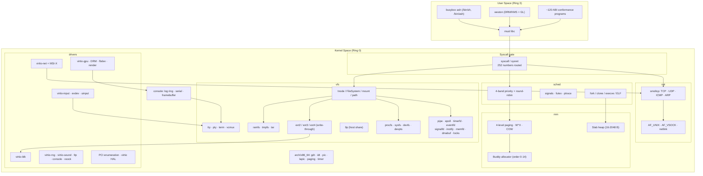
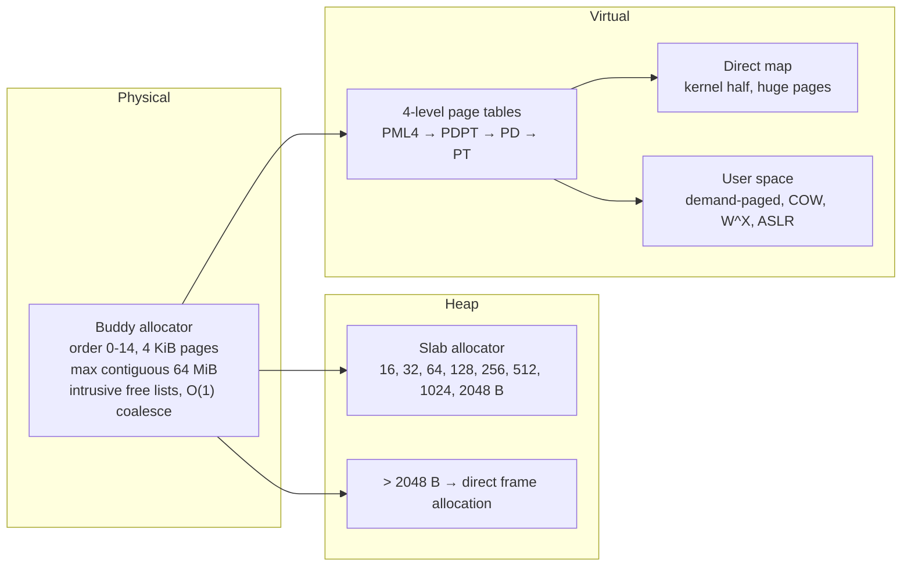
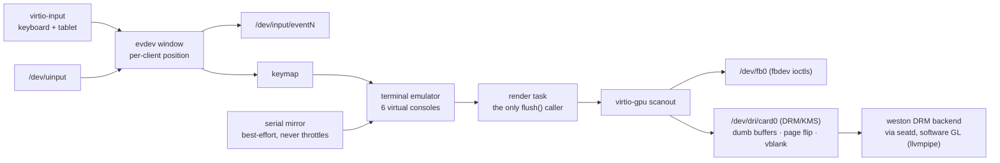
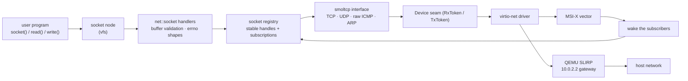

# MPOS

<div align="center">


**A Milestone-Verified Operating System Kernel**

A uniprocessor x86_64 operating system kernel in Rust, booted on UEFI by its own loader. Every
subsystem is proven correct before the next one is built — from the frame allocator to an
interactive shell. Linux ABI compatible: musl-based binaries run unmodified.

[Quick Start](#quick-start) · [Architecture](#architecture) · [Syscalls](#syscalls) · [Milestones](#milestone-checks) · [Building](#building) · [Testing](#testing) · [Docs](#documentation) · [中文](docs/README.zh.md)

</div>

---

## Overview

**MPOS** is a teaching and research operating system kernel built around a **milestone
verification** methodology: rather than adding layers and hoping, each one is proven correct by
assertions and tests before the next is built — and the proofs live in two places, so neither
can rot quietly.

- **On the host.** Architecture-independent logic lives in the kernel *library*
  (`src/lib.rs`): the frame allocator, the mapping plan, the scheduler's policy, path
  resolution, every filesystem's encoding, the pure half of each device's ioctl contract. It
  compiles for `x86_64-unknown-linux-gnu` and runs under plain `cargo test`.
- **On the machine.** ~120 user-space programs are booted in QEMU and must report
  `=== PASS`; they speak the Linux ABI through real `syscall` instructions, with the numbers
  taken from the kernel's own `src/syscall/linux/nr.rs`, so kernel and tests cannot disagree
  about a number without one of them failing to build.

Machine-dependent code — descriptor tables, port I/O, virtio rings, the boot handoff — is gated
behind `#[cfg(target_os = "none")]`, which is what keeps the host build free of hardware.

### Core features

| Feature | Description |
|---------|-------------|
| **Own UEFI loader** | `mpos-boot` reads the kernel, the initramfs and the command line off the ESP, builds the page tables and the higher-half mapping, applies the kernel's relocations and jumps — then stops existing. No third-party bootloader, no ISO |
| **Linux ABI compatible** | 252 Linux x86_64 syscall numbers are named and routed; musl binaries (Alpine, busybox, `apk`, `fish`, weston) run unmodified |
| **Framebuffer console** | virtio-gpu 2D scanout, a kernel console that *moves onto it* after boot, virtual consoles (`Ctrl-A 1..6`; the image runs a `getty` on `tty1`..`tty4`), and a best-effort serial mirror that never throttles the window |
| **DRM/KMS + fbdev** | `/dev/fb0` with the fbdev ioctls and `/dev/dri/card0` speaking the Linux DRM UAPI — dumb buffers, page flip, vblank events, render node, PRIME. This is the path **weston** takes: its DRM backend through `seatd`, with Mesa's software GL (llvmpipe) over GBM dumb buffers. No GPU-side 3D and no virgl |
| **Input** | virtio-keyboard and virtio-tablet as evdev nodes (`/dev/input/eventN`, capability ioctls, per-open-file grab), plus `/dev/uinput` so a program can create a device of its own |
| **Write-through ext2/ext4** | Full read/write ext2, ext3 and ext4 — extents, directory hashing, 4-way set-associative block cache — with write-through semantics: no journal, no dirty tracking, crash-visible |
| **Priority scheduler** | Strict priority across four bands (LOW, NORMAL, HIGH, CRITICAL), round-robin within a band, deadline-based sleeps, COW fork, demand-paged stack growth |
| **Signals** | Handlers delivered through a real `rt_sigframe`, mask enforcement, `sigqueue`/`siginfo` payloads, `SIGKILL`/`SIGSTOP` unblockable |
| **TCP/IP networking** | smoltcp-driven stack with TCP, UDP, raw ICMP and ARP over virtio-net, MSI-X interrupts, and event-driven waits that end a blocked reader when a frame arrives rather than at the next tick |
| **AF_UNIX** | Path-based `SOCK_STREAM` with `SCM_RIGHTS` descriptor passing, `SCM_CREDENTIALS` and `SO_PEERCRED` — enough for a real `dbus` broker and `udev`'s worker channel |
| **Interactive shell** | Alpine's OpenRC boot into a `getty` on a pty-backed `/dev/tty1` (four consoles by default, edited in `rootfs/etc/inittab`), with pipes, redirection, background jobs and a scriptable init |

---

## Architecture

`docs/ARCHITECTURE.md` has the full module graph, the measured dependency edges, the boot sequence
diagram and the layering rules. This is the summary.

### System overview



### Boot flow

```mermaid
graph TD
    A["UEFI firmware"] --> B["EFI/BOOT/BOOTX64.EFI — mpos-boot"]
    B --> B1["inflate the kernel carried inside the loader, read initramfs.tar + mpos.cmdline from the ESP"]
    B1 --> B2["memory map · page tables · direct map at KERNEL_VIRT_BASE"]
    B2 --> B3["relocate the PIE image · exit boot services"]
    B3 --> C["_start(handoff) — ring 0, kernel stack, interrupts off"]
    C --> C1["console::init() · enable_user_sse() · handoff::collect()"]
    C1 --> D["mm::init() → logging::init()"]
    D --> E["init_arch: gdt · idt · pic · timer · rtc · syscall gate · paging::install()"]
    E --> F["init_sched: adopt the boot task"]
    F --> G["init_vfs: ramfs root, untar the initramfs"]
    G --> H["init_pci → init_blk: virtio-blk, GPT scan, mount /mnt"]
    H --> I["init_net: virtio-net, smoltcp, 10.0.2.15/24"]
    I --> J["init_virtio: rng · console · gpu · input · sound · 9p · vsock"]
    J --> K["rand::init(): ChaCha20 from RDRAND + host entropy"]
    K --> L["handoff_to_init: spawn /init as PID 1, park the boot task"]
    L --> M["initramfs /init: mount proc · sysfs · devtmpfs"]
    M --> N["mount /dev/vda2 (ext4), mount proc/sys/tmp/run, move /dev, devpts"]
    N --> O["switch_root /sysroot /sbin/init"]
    O --> P["OpenRC: services, devfs, networking"]
    P --> Q["shell on /dev/tty1 (pty-backed)"]
```



The kernel mounts nothing but its own ramfs root. `/proc`, `/sys`, `/dev`, the real root and the
`switch_root` all belong to the initramfs's `/init` (`assets/initramfs/core/init`), because a kernel
that assembles them first leaves pieces that the owner of the system cannot unmount.

### Memory management



### Console, display and input



### Network data path



---

## Syscalls

`src/syscall/linux/nr.rs` names **252 Linux x86_64 syscall numbers**; every one of them is
routed by the dispatch table in `src/syscall/linux/mod.rs`, and roughly 234 do real work — the
handful that do not answer `ENOSYS`, which `docs/notes/` tracks as the remaining ABI gap
(`fanotify`, `keyctl`, `userfaultfd`, real-time signals 33–64, `io_uring`). The POSIX interval
timers (`timer_create` 222 … `timer_delete` 226) joined that set with the five numbers they are;
`SIGRTMIN` (32) is queued, masked and waited for — the one real-time number musl's
`SIGEV_THREAD` helper needs — while a *disposition* for it, and the range above it, is still
refused.

Where the handlers live, and why the files are as big as they are:

| Handler module | Numbers | What it answers |
|---|---:|---|
| `syscall/linux/fs/file.rs` + `fs/ioctl.rs` | 135 | Everything that carries a path or drives a file descriptor: `open`/`openat`/`openat2`, `stat`/`statx`, `getdents64`, `renameat2`, `splice`, `mount`, `fcntl`, pipes, `sendfile`, `fallocate`, `statfs` — in `file.rs`; the device-`ioctl` entry point in `ioctl.rs`. The old single `fs.rs` split along that seam at notes/ §11.2 Step E |
| `syscall/linux/proc.rs` | 50 | Memory and process machinery: `mmap`/`munmap`/`mremap`/`brk`/`mprotect`, `fork`/`clone`/`vfork`, `execve`, `exit_group`, `wait4`/`waitid`, `ptrace`, `process_vm_readv`/`writev`, `nanosleep`, `clock_gettime`, `gettimeofday` |
| `syscall/linux/posix.rs` | 50 | The POSIX completion set: the identity family (`setreuid`, `getresuid`, `capget`…), capabilities, `sched_*`, `getpriority`/`setpriority`, memory advice (`msync`, `madvise`, `mlock`), the wall-clock setters, self-directed signals |
| `syscall/linux/abi.rs` | 12 | Pure ABI facts — flag values, struct layouts, argument validation, encodings — host-compiled so the man-page contract is unit-testable |
| `syscall/linux/nr.rs` | — | The numbers themselves, included by the test suite with `#[path]` so kernel and tests share one table |

`ioctl` deserves a note: its request-number families for fbdev, DRM, RTC, uinput, evdev, TTY and
block devices are parsed in `syscall/linux/fs/ioctl.rs` — the old single `fs.rs` grew past 6 300 lines
holding that switchboard alongside the path/file calls, so notes/ §11.2 Step E split the file along
that seam (the switchboard itself is unchanged). `docs/notes/` Phase 11 (Step B) is the plan to give each
driver its own contract back.

Deliberate divergences from Linux are collected per subsystem in `docs/notes/` — for example
`SO_SNDBUF`/`SO_RCVBUF` are recorded but do not resize the stack's buffers, real `MSG_PEEK`
over TCP/UDP is refused `EOPNOTSUPP`, and the `xattr` family validates and then refuses. They
are recorded there rather than hidden here.

---

## Milestone checks

Each subsystem is proven before the next is built. The on-machine half of that proof is the
kernel's own suites: one `mpos-kunit: <suite>.<case> OK` line per case and a tally at the end,
and they run **only** in a *test* build — the one `cargo xtask test` builds with `--features
selftest`. A production kernel carries neither the suites nor the harness that runs them, so an
ordinary boot pays none of the half-second clock wait and the scheduler sleeps these cases need.

| Case | What is verified |
|------|------------------|
| `mm.frames`, `mm.large_block`, `mm.heap` | The zones exist and a block survives the direct map; buddy blocks are disjoint and coalesce; every slab size class holds its contract; heap and frame allocator agree on what was handed out |
| `arch.clock_breaks_registers` | The clock ticks at the rate it declares; a breakpoint exception is catchable and returns; the machine's register-file table agrees with the host-built ABI table, field by field |
| `arch.page_tables_and_spaces` | The kernel runs on its own page tables; `text` is `r-x`, `rodata` `r--`, `data` `rw-` across the whole image; user address spaces are isolated with a shared kernel half; both are torn down without leaking a frame |
| `sched.alternating` … `sched.stacks_returned` (seven cases) | Round-robin, preemption, sleep, idle wake-up and priority-based core stealing; then that every task was reaped and every stack returned |
| `vfs.ramfs_file`, `vfs.mounted_tree_multi_task` | ramfs root, a mount crossed by resolution, two tasks reading and writing one file through the fd table |
| `syscall.gate`, `syscall.dispatch_in_task` | The dispatch gate answers correctly from the kernel and from inside a task; `exit_group` through dispatch ends it |
| `ipc.pipes`, `ipc.tty`, `ipc.signals` | Bytes cross a pipe between two tasks, and `EPIPE` with no reader; line editing, echo and `Ctrl-D`; `SIGTERM`/`SIGKILL` land and the `kill(0)` probe answers |
| `boot.stack_depth` | The loader's canary at the bottom of the boot stack is intact once everything above has run |

The second machine answers the cases it can answer — `arch.console_receive` and
`arch.console_transmit` where the first has its two paging cases — and prints the same kind of
tally.

**The boot's own checks are not tests, and they run on every boot.** A device the machine was
configured with, a filesystem it must mount, the devfs it must publish: those are asserted on the
way past, and a failure halts the machine with a line that names the subsystem (`virtio-blk: …`,
`9p: …`, `devfs: …`). What such a check asserts is the **kernel's** behaviour and nothing the build
packed into an image: `check_blk` finds a filesystem-less device by the kernel's own partition-and-
superblock scan and round-trips a pattern it generates, `check_fs` writes its own marker through the
mounted ext4 and reads it back, and `check_p9` reads the share's root inode — no check names a file
an image has to carry (`docs/notes/` §15.34). The kernel prints no milestone markers any more:
nothing parsed them once the sweep's own `=== SUMMARY` line and the harness's tally became the gate
(`docs/notes/` §15.19, §15.24).

**The real gate is the self-test.** `cargo xtask test` runs the host unit tests and then boots
the user test programs `tests.toml` selects — every program that is not in a group — requiring
each to print `=== PASS` and the run to end with a `=== SUMMARY` line and QEMU exit code 33.
The tests that need something outside the machine, or that measure rather than assert, are in
groups and run by name (`--groups`, `--all-groups`), which is what keeps a red gate a statement
about the kernel. Those reason groups live in `tests.toml`'s `[default]` section and bind both
machines; each machine's own `[x86_64]`/`[aarch64]` section holds only its `gaps` — what that
machine cannot serve yet, which no run may ask for by name. See [Testing](#testing).

---

## Quick Start

### Prerequisites

- **Rust nightly** with `rust-src`, `rustfmt`, `clippy`
- Four targets: `x86_64-unknown-none` (kernel), `x86_64-unknown-uefi` (loader),
  `x86_64-unknown-linux-musl` (user programs), `x86_64-unknown-linux-gnu` (host tests + xtask)
- **QEMU** (`qemu-system-x86_64`), **OVMF** (`OVMF_CODE.4m.fd` / `OVMF_VARS.4m.fd`)
- `qemu-img`, `qemu-nbd`, `sfdisk`, `partx`, `blkid`, `mkfs.ext4`, `mkfs.fat`, `tar`, `sudo`
- A network connection for the first `initramfs`/`rootfs` build (Alpine packages)

```bash
rustup toolchain install nightly
rustup component add rust-src rustfmt clippy --toolchain nightly
rustup target add x86_64-unknown-none x86_64-unknown-uefi \
                   x86_64-unknown-linux-musl x86_64-unknown-linux-gnu
```

### Build and run

```bash
cargo xtask all          # kernel + loader + initramfs + disk image + Alpine rootfs (needs sudo)
cargo xtask run          # boot it; rebuilds first if anything is stale
```

The kernel boots, brings up the initramfs, pivots into the Alpine root filesystem and drops you
into an interactive shell — on the serial line, in the QEMU window, or in both, depending on the
mode below.

`cargo xtask run` takes a mode that decides how the window and the serial line are wired, and
which consoles the guest is told it has. The guest is told with Linux's own `console=` words,
and nothing else: every console on the list receives the log and the last one is the preferred
console — the one whose writes wait rather than being dropped.

| Mode | What you get | Guest `console=` |
|------|--------------|------------------|
| `terminal` | Serial only, no window — the lossless log; `/dev/fb0` still exists, nothing is drawn on it | `console=ttyS0` |
| `gui` | The whole machine in the window: the text console — log, virtual consoles, login, shells — shows there, and the host terminal stays quiet with the serial line copied to `build/serial.log`; a compositor claimed it at runtime with `./start-weston.sh` | `console=tty0` |
| `mirror` | The window plus a best-effort copy on the serial line (the default) | `console=ttyS0 console=tty0` |

```bash
cargo xtask run --mode terminal      # watch the boot log
cargo xtask run --mode gui           # the machine, in the window
```

Three modes, because the guest's consoles and the launcher's window are separate
questions, and each mode owns an answer. What a command line can never say is
*who is drawing the screen*: a compositor takes it at runtime, through
`DRM_IOCTL_SET_MASTER` and `KDSETMODE`, whichever windowed mode it starts in.

`xtask/README.md` documents every command, flag and environment variable, in English and
Chinese. In short:

| Command | What it does | Root? |
|---|---|---|
| `cargo xtask build` [`--arch x86_64\|aarch64`] | Kernel + UEFI loader, for the machine `--arch` names (it drives both `--target`s) | no |
| `cargo xtask initramfs` | Build the initramfs archive | yes |
| `cargo xtask disk` | Create the empty GPT image | yes |
| `cargo xtask rootfs` | Install Alpine into the image (refreshes the initramfs) | yes |
| `cargo xtask run` | Boot in QEMU, rebuilding when stale | when needed |
| `cargo xtask all` | All of the above, in order | yes |
| `cargo xtask test` | Host unit tests + the user test programs `tests.toml` selects, in QEMU | **no** |
| `cargo xtask clean` | Remove `build/` and `target/` | when needed |

---

## Building

The build is a Cargo workspace with one front-end. `xtask` compiles as your own user and
escalates only for the steps that genuinely need it (writing a block device, mounting an image,
`chroot`), handing the artefacts back afterwards.

```bash
cargo xtask build                        # kernel and loader only
cargo build --target x86_64-unknown-none # the same, without xtask
```

### The disk image

`cargo xtask all` assembles `build/mpos-uefi-x86_64.img`: a GPT disk with two partitions.

| # | Name | Type | Size | Contents |
|---|------|------|------|----------|
| 1 | `efi` | FAT32, bootable | 128 MiB (from `rootfs.toml`) | `EFI/BOOT/BOOTX64.EFI` (the loader), `mpos.elf`, `initramfs.tar`, `mpos.cmdline` |
| 2 | `system` | ext4 | rest of the 2 GiB image | The Alpine root filesystem — `/sbin/init`, OpenRC, musl, busybox, `apk` |

QEMU boots it directly under OVMF: no ISO, no optical drive, no loop device, and no root needed
for `cargo xtask test`, which boots a directory QEMU synthesizes as virtual FAT.

### What goes in the image

`rootfs.toml` decides the packages, the filesystem, the sizes, the hostname, DNS and the user
account; `machine.toml` decides what the image is booted on (memory, cpus, devices, the window,
the standing run mode), which is a separate file so that tuning the machine cannot invalidate
the image; `initramfs.toml` does the same for the early userspace. All three are one file each for
*both* machines, in three sections: `[default]` is the baseline both read, and `[x86_64]`/`[aarch64]`
are each machine's own half — so a value the second machine does not share is written once, under its
own name, and the first machine never sees it. Concrete
files live as real files under `assets/rootfs/` and `assets/initramfs/`, overlaid *after* anything
written from the toml — so a file in the tree wins, which is how `/etc/inittab`,
`/etc/network/interfaces` and `/init` are edited. Both trees are in the same three parts: a `core/`
half merged first, where one answer for both machines goes, and then each machine's own tree over
it — the `/init` the two machines run is one file, `assets/initramfs/core/init`.

### Cross-architecture

Not available, and the configuration no longer pretends otherwise: there is no
`aarch64-unknown-none` profile in `.cargo/config.toml` and no such target in
`rust-toolchain.toml`, because the profile that used to sit there named
`arch/aarch64/linker.ld` and no such script has ever existed (`docs/notes/` Phase 11
Step A removed it). `docs/notes/` §9.1 lists what a real aarch64 port needs - the
exception vectors, the GIC, the page tables, PSCI, the generic timer, a UART -
and none of it is written.

---

## Testing

Three layers, and the middle one is the gate.

### 1. Host unit tests

```bash
cargo test -p mpos --lib --target x86_64-unknown-linux-gnu
cargo test -p mpos-xtask --target x86_64-unknown-linux-gnu
```

491 `#[test]` functions in the kernel plus 25 in `xtask`. They cover the arch-independent core:
the buddy allocator and the slab heap, the scheduler's policy and signal state, path resolution
and mounting, ext2/ext3/ext4 encoding (including a byte-for-byte read of a large file and a
mount of an image the host's `mke2fs` made), the ext4 block cache's hit counts, ramfs chunking
and its byte budget, pipe rings, the epoll readiness rules, the evdev window's client
accounting, inotify's coalescing, the file-lock table, the keymap, the calendar, the shebang
parser and the ABI constants.

> **`--target` is mandatory.** The root `.cargo/config.toml` pins `[build] target =
> "x86_64-unknown-none"`, so a bare `cargo test` tries to run the tests on bare metal.

### 2. The self-test sweep — the gate

```bash
cargo xtask test        # needs no root
```

It builds the two user test crates, packs them into a throwaway initramfs with a generated
`/init`, boots it headless, and parses the serial log:

```
=== RUN  t-filelock
=== PASS t-filelock
=== SUMMARY pass=120 fail=0
=== END
```

A program that hangs, crashes or never prints `=== PASS` counts as a failure, and the run must
end with the summary line *and* QEMU's clean debug exit (code 33). `MPOS_TEST_TIMEOUT` overrides
the 900-second budget.

Which programs are booted is `tests.toml`'s answer, not the `/init`'s: the harness stages the
selected binaries into `/bin` and the guest runs what it was given. A test in no group always
runs; the shipped groups are `external` (the host's network, or a listener on the host),
`slow` (measurement, or seconds of work) and `diagnostic` (not a check at all), and
`cargo xtask test --groups <a,b>` / `--all-groups` runs them on purpose. The sweep prints what
it left out, group by group, so a smaller number is never mistaken for a smaller suite.

### 3. The user test programs

~120 programs, split by what each one needs:

| Group | Where | Built as | What it pins |
|-------|-------|----------|--------------|
| **Pure syscall** | `user/abitest/src/bin/syscall/` (86) | `no_std`, raw `syscall`, static `ET_EXEC` | One syscall family's ABI contract on self-contained resources: the success shape, every errno it claims, and the edge cases the man page fixes |
| **Integration** | `user/abitest/src/bin/integration/` (22) | `no_std`, raw `syscall` | A device, the network, another process image or a subsystem end to end — plus the timing instruments (`t-forkcost`, `t-pipecost`, `t-netlat`) |
| **std side** | `user/tests/src/bin/` (12) | static musl + `rustix` | The surface a real musl program speaks, for the behaviour easiest to pin from a hosted language: sockets, name lookup, spawning |

The `no_std` programs take their numbers from the kernel's own `nr.rs` through
`#[path = "../../../lib/lin.rs"]`, so a wrong number is a build failure rather than a wrong
test. The `std` tests use `rustix` rather than inline assembly, deliberately: a hand-written
`syscall` instruction can pass against a kernel that is wrong, because the errno is whatever the
register happened to hold.

### 4. Fuzzing

`fuzz/` is a separate workspace with 18 libFuzzer targets over the parsers that decide what the
kernel trusts from bytes: ELF, ustar, ext2/ext4 on-disk structures, partition tables, VFS paths,
the console's escape parser, the keymap, PCI BAR sizing, the scheduler's policy and the input
protocols.

```bash
cd fuzz
cargo fuzz run ext4_image
cargo fuzz list
```

---

## Project layout

```
mpos/
├── src/                     # the kernel crate: lib.rs (host-testable) + main.rs (boot entry)
│   ├── lib.rs               # library root — what the host build compiles
│   ├── main.rs              # _start → kernel_main → milestone checks → init handoff → park
│   ├── console.rs           # log ring, serial output, the move onto the framebuffer
│   ├── binfmt.rs            # shebang (#!) interpreter
│   ├── date.rs              # civil calendar arithmetic
│   ├── evdev.rs             # evdev record window and per-client positions (host-testable)
│   ├── uinput.rs            # uinput's interface: requests and bitmaps (host-testable)
│   ├── pci.rs               # the PCI device model and Linux's spellings (host-testable)
│   ├── rand.rs              # ChaCha20 PRNG: /dev/urandom, getrandom
│   ├── uevent.rs            # kobject events and the netlink wire format
│   ├── logging.rs           # the tracing subscriber that writes to COM1
│   ├── sync/mod.rs          # the locking doctrine (critical_section, never spin)
│   │
│   ├── arch/x86_64/         # machine-dependent half
│   │   ├── context.rs       #   task context switch, lazy FPU (CR0.TS + #NM)
│   │   ├── critical.rs      #   critical_section (cli/sti)
│   │   ├── gdt.rs           #   GDT + TSS
│   │   ├── idt.rs           #   interrupt handlers (timer, #BP, #PF, #NM, syscall, MSI-X)
│   │   ├── lapic.rs         #   local APIC (EOI, MSI-X vector programming)
│   │   ├── paging.rs        #   4-level page tables, W^X, COW, AddressSpace
│   │   ├── pic.rs           #   8259 PIC (IRQ0→32, IRQ4→36)
│   │   ├── rtc.rs           #   CMOS RTC as the wall-clock anchor
│   │   ├── syscall.rs       #   the syscall/sysret gate
│   │   └── timer.rs         #   PIT at 250 Hz + TSC sub-tick reading
│   │
│   ├── mm/                  # memory management
│   │   ├── pframe.rs        #   buddy frame allocator (MAX_ORDER 12)
│   │   ├── heap.rs          #   slab kernel heap (16–2048 B)
│   │   ├── vm.rs            #   mapping plans, KernelSections
│   │   └── elf.rs           #   ELF64 loader (ET_EXEC and ET_DYN + relocations)
│   │
│   ├── sched/               # tasks
│   │   ├── policy.rs        #   priority bands, round-robin, sleep queue
│   │   ├── runtime/         #   task table (64 slots), switch, fork/exec/wait, teardown
│   │   │                    #     task · child_mm · child_signal · child_exit · load
│   │   │                    #     · trace · procfs
│   │   ├── signal.rs        #   signal numbers, pending bitmask, dispositions
│   │   └── futex.rs         #   futex wait/wake
│   │
│   ├── vfs/                 # the virtual filesystem
│   │   ├── mod.rs           #   Inode/FileSystem traits, NodeKind
│   │   ├── mount.rs         #   Vfs, mount table, path resolution, pivot_root
│   │   ├── path.rs          #   path parsing
│   │   ├── file.rs          #   fd table, CLOEXEC, RLIMIT_NOFILE
│   │   ├── ramfs.rs         #   ramfs/tmpfs: chunked files, byte budget
│   │   ├── ext4/            #   ext2/ext3/ext4: super · inode · extent · dir · dx · hash
│   │   │                    #     · alloc · dirent · csum · mapping · cache
│   │   ├── procfs.rs        #   /proc: meminfo, stat, mounts, net, sys knobs, per-pid
│   │   ├── sysfs.rs         #   /sys: devices, class, drm, input, uevents
│   │   ├── devfs.rs         #   /dev node kind and request routing
│   │   │                    #     (the standard node set lives in drivers/devices.rs:
│   │   │                    #      null, zero, tty, console, fb0, dri, rtc0, dsp, hvc0, …)
│   │   ├── devpts.rs · pty.rs · tty.rs · termios.rs   # terminals
│   │   ├── term/            #   the terminal emulator: grid · blit · font · keymap
│   │   ├── vcmux.rs         #   the virtual-console multiplexer
│   │   ├── pipe.rs          #   pipes and socketpairs (ring buffer, SCM handover)
│   │   ├── epoll.rs · timerfd.rs · eventfd.rs · signalfd.rs · inotify.rs
│   │   ├── memfd.rs · dmabuf.rs      #   anonymous and exported buffers
│   │   ├── locks.rs         #   POSIX record locks and flock
│   │   ├── p9.rs            #   the 9p client (host share)
│   │   └── tar.rs           #   ustar unpacker for the initramfs
│   │
│   ├── net/                 # networking
│   │   ├── mod.rs           #   smoltcp stack, registry, wakeups, netlink write side
│   │   ├── socket.rs        #   AF_INET / AF_NETLINK socket syscalls
│   │   ├── unix.rs          #   AF_UNIX: path sockets, SCM_RIGHTS, SO_PEERCRED
│   │   ├── rtnl.rs          #   rtnetlink: addr/route/link, applied live
│   │   └── vsock.rs         #   AF_VSOCK
│   │
│   ├── drivers/             # devices
│   │   ├── pci.rs           #   PCI config space (mechanism 1), enumeration
│   │   ├── devices.rs       #   device registry, uevent publishing
│   │   ├── serial.rs        #   COM1: TX ring, interrupt-driven RX
│   │   ├── rtc_dev.rs       #   /dev/rtc0 (the node; the clock is arch::x86_64::rtc)
│   │   ├── qemu.rs          #   the isa-debug-exit test port
│   │   ├── drm/             #   /dev/dri/card0: the Linux DRM/KMS UAPI
│   │   │                    #     abi · state · ioctl · props · fb · flip · sync
│   │   │                    #     · master · virtgpu · card
│   │   ├── uinput.rs        #   /dev/uinput
│   │   ├── video/           #   the render task and the present engine
│   │   └── virtio/          #   hal · blk · net · gpu · input · console · rng
│   │                        #     · sound · fs9p · vsock · msix
│   │
│   ├── syscall/             # the ABI
│   │   ├── mod.rs           #   error codes, user-buffer validation, trace ring
│   │   └── linux/           #   mod (dispatch) · nr (numbers) · abi · fs · proc · posix
│   │
│   ├── blk/                 # BlockDev trait, GPT/MBR partition scanning
│   └── boot/                # the handoff record the loader leaves behind
│
├── boot/                    # mpos-boot: the UEFI loader (x86_64-unknown-uefi)
│   └── src/                 # main (the ordered sequence) · elf · vm · handoff
│
├── user/                    # programs that run on mpos
│   ├── src/bin/             #   ordinary std programs shipped in the image (hello.rs)
│   ├── tests/               #   mpos-user-tests: the std-side test programs (musl)
│   ├── abitest/             #   mpos-user-abi: the no_std ABI conformance suite
│   │   ├── lib/lin.rs       #     the harness: syscall stubs, verdict protocol
│   │   └── src/bin/         #     syscall/ (86) · integration/ (22)
│   └── staging/             #   scratch sources, not wired into any build
│
├── xtask/                   # the build/run/test front-end (see xtask/README.md)
├── fuzz/                    # libFuzzer targets (its own workspace)
├── arch/x86_64/linker.ld    # the kernel linker script
├── rootfs/                  # files overlaid into the Alpine root filesystem
├── rootfs.toml              # what the guest image contains
├── machine.toml             # what that image is booted on (host resources, run mode)
├── tests.toml              # which user tests the default sweep runs (and which it leaves out)
├── initramfs/               # files overlaid into the early userspace (init lives here)
├── initramfs.toml           # what the early userspace contains
├── .cargo/config.toml       # targets, rustflags and the `cargo xtask` alias
├── rust-toolchain.toml      # nightly + the four targets
├── docs/                    # ROADMAP.md · notes/ · uapi/ · ARCHITECTURE.md · README.zh.md
├── README.md · AGENTS.md
└── LICENSE
```

`docs/ARCHITECTURE.md` has the same tree as a dependency graph, with the measured edges between
layers; `AGENTS.md` is the short version for anyone (or anything) about to make a change.

---

## Design principles

- **Library/binary split.** The crate is a library so the host can test it. Machine code is
  gated behind `target_os = "none"`; pure logic — arithmetic, encodings, parsers, policies —
  stays on the host side even when its only caller is bare metal.
- **One syscall table.** The test suite includes `src/syscall/linux/nr.rs` with `#[path]`, so
  kernel and tests cannot drift apart on a number without a build failure.
- **Uniprocessor simplicity.** All shared state is `critical_section::Mutex<RefCell<T>>` —
  interrupts disabled *is* mutual exclusion. `spin::Mutex` is deliberately never used: busy-waiting
  on a lock held by a task this core just preempted would deadlock. Nothing sleeps under a lock.
- **Every wake is an event, not a tick.** A blocking call parks on the thing it is waiting for
  and is woken by the arrival, not by the next clock interrupt. This single discipline is what
  took loopback `ping` from 7.5 ms to 0.3 ms and a two-process pipe handover from 7 MiB/s to
  10 168 MiB/s (`docs/notes/` §10.1, §10.4).
- **Nothing is claimed without a number.** Performance changes in `docs/notes/` carry before/after
  measurements from an instrument that runs in the suite — `t-forkcost`, `t-pipecost`,
  `t-netlat`, or a host test that counts device reads.
- **Divergences are recorded, not hidden.** Where MPOS deliberately differs from Linux, the
  reason and the test that pins it are written down next to the feature.

### Behaviour worth knowing

| Behaviour | Note |
|---|---|
| **COW fork** | Shared pages are marked read-only with a COW bit; the `#PF` handler copies on first write. Frame reference counts live in the buddy allocator |
| **Demand-paged stack** | Starts at 16 pages and grows on fault, bounded by `RLIMIT_STACK` with `STACK_GROWTH_SLACK` for the check |
| **Write-through ext4** | Every `write_at()` reaches the device. No journal, no dirty tracking, no background writeback: simple, and crash-visible by construction (the image is built `^has_journal,^metadata_csum` for the same reason) |
| **Signals** | Delivered through a real `rt_sigframe`, so a handler is called and `rt_sigreturn` resumes the interrupted code. `SIGKILL` and `SIGSTOP` cannot be blocked |
| **ASLR** | An `ET_DYN` image, its interpreter, the stack top and the `mmap` region are all drawn per `exec`; an `ET_EXEC` image keeps the address it was linked at, because that is what a fixed address means |
| **Slab allocation and large requests** | Requests over 2048 B bypass the slab and take frames directly; the heap keeps freed slots cached, which is why "free" memory in `/proc/meminfo` is not the whole story |
| **Kernel panics end the machine** | `panic = "abort"` and a panic handler that dumps a stack scan and exits QEMU with `35`. The global allocator's failure path is still a panic — an open item in `docs/notes/` §8.0 |

---

## Documentation

| File | What it is |
|---|---|
| `README.md` | This file: what MPOS is and how to build, run and test it |
| `AGENTS.md` | The working guide: commands, conventions, recipes for adding a syscall or a test, known traps |
| `docs/README.zh.md` | Chinese translation, kept in section-by-section correspondence with this file |
| `docs/ARCHITECTURE.md` | The dependency graphs, the boot and syscall sequences, per-layer ownership, the measured inter-module edges, and the layering violations |
| `docs/ROADMAP.md` | The plan: the feature roadmap and status board, the remaining work per phase, and what to do next |
| `docs/notes/` | The evidence library: one file per phase plus an index (`index.md`) — every measurement, gate run, lesson and trap, the measured performance work, and Phase 11's architecture-debt audit and remediation plan. A `§N.M` pointer routes through `docs/notes/index.md` |
| `docs/uapi/` | The userspace-visible surface as an inventory: syscalls, device ioctls, struct layouts and flag vocabularies, each with Linux's answer, this kernel's, and the pin — the working list of what is served, honestly refused, or a wrong shape |
| `xtask/README.md` | Every build/run command, flag and environment variable (bilingual) |
| `fuzz/README.md` | What each fuzz target feeds on |

---

## License

This project is licensed under the [MIT License](LICENSE).

---

<div align="center">
<sub>Built with Rust — proven correct, one milestone at a time.</sub>
</div>
