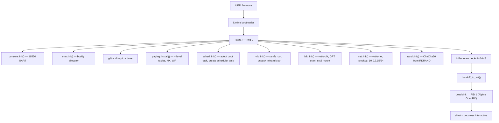
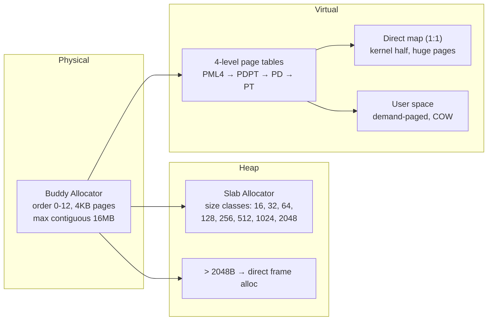
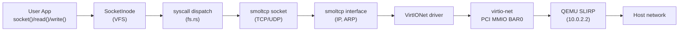

# MPOS

<div align="center">


**A Milestone-Verified Operating System Kernel**

A minimal, milestone-verified operating system kernel written in Rust, booted via the Limine protocol. Every subsystem is proven correct before the next one is built—from the frame allocator to a fully interactive shell. Linux ABI compatible: musl-based binaries run unmodified.

[Quick Start](#-quick-start) · [Architecture](#-architecture) · [Syscalls](#-syscalls) · [Milestones](#-milestones) · [Building](#-building) · [Testing](#-testing) · [中文](README.zh.md)

</div>

---

## Overview

**MPOS** is a teaching and research operating system kernel built around a **milestone verification** methodology. Rather than building the kernel incrementally, MPOS proves each layer correct via assertions and host-side unit tests before building the next one.

The kernel is organized as a **Rust library** (`src/lib.rs`) that can be unit-tested on the host (`cargo test --lib --target x86_64-unknown-linux-gnu`), while a thin binary entry point (`src/main.rs`) walks through the M0–M14 milestone verification pipeline on QEMU.

### Core Features

| Feature | Description |
|---------|-------------|
| **Milestone Verification** | Each subsystem is proven correct before the next is built. Serial logs carry markers (`M0_OK` through `M14_OK`) asserted by the test harness. |
| **Host-Testable Split** | Architecture-independent code lives in the library crate and runs on the host via `cargo test`. Machine-dependent code is gated behind `#[cfg(target_os = "none")]`. |
| **Linux ABI Compatible** | ~155 Linux x86_64 system calls implemented. musl binaries (Alpine, busybox) run unmodified on the kernel. |
| **Write-Through ext2** | Complete read/write ext2 with write-through semantics—no journal, no dirty page tracking, crash-visible. |
| **Priority Scheduler** | Strict priority across four bands (LOW, NORMAL, HIGH, CRITICAL), round-robin within a band, deadline-based sleep queue, COW fork, demand-paged stack growth. |
| **TCP/IP Networking** | smoltcp-based stack with TCP, UDP, ICMP, ARP over virtio-net. AF_INET only—sufficient for musl's DNS resolver and apk's HTTP. |
| **Interactive Shell** | Alpine's ash shell with pipes, redirection, environment variables, background jobs, and a scriptable init. |

---

## Architecture

### System Overview

```mermaid
graph TB
    subgraph UserSpace["User Space (Ring 3)"]
        MUSL["musl libc"]
        ASH["/bin/sh (ash)"]
        BUSYBOX["busybox applets"]
        TESTS["60+ ABI conformance tests"]
    end

    subgraph KernelSpace["Kernel Space (Ring 0)"]
        subgraph SyscallGate["Syscall Gate (~155 Linux x86_64 calls)"]
            SYSCALL["syscall / sysret"]
        end

        subgraph VFS["VFS Layer"]
            VFS_CORE["Inode trait + mount table"]
            RAMFS["ramfs (initramfs, tmpfs)"]
            EXT2["ext2 (read/write)"]
            DEVFS["devfs (/dev/null, tty, console, ...)"]
            PROCFS["procfs (/proc/meminfo, cmdline, ...)"]
            SYSFS["sysfs (/sys/class/block, ...)"]
            DEVPTS["devpts (/dev/pts/*)"]
            TTY["TTY (line discipline)"]
            PIPE["pipe + socketpair"]
            SIGNalfd["signalfd / eventfd"]
        end

        subgraph Process["Process Management"]
            SCHED["Scheduler (4-level priority + RR)"]
            SIGNAL["Signal handling"]
            FUTEX["Futex (wait/wake)"]
            FORK["fork / clone / execve"]
        end

        subgraph Memory["Memory Management"]
            PMM["Buddy allocator (order 0-12)"]
            SLAB["Slab heap (16-2048 bytes)"]
            PAGE["4-level page tables (W^X)"]
            COW["Copy-on-Write fork"]
            ELF["ELF64 loader"]
        end

        subgraph Drivers["Device Drivers"]
            VBLK["virtio-blk"]
            VNET["virtio-net"]
            UART["16550 UART"]
            PCI_BUS["PCI bus enumeration"]
        end

        subgraph Net["Networking"]
            SMOLTCP["smoltcp (TCP/UDP/ICMP/ARP)"]
            NETLINK["Netlink (rtnl)"]
        end
    end

    MUSL --> SYSCALL
    ASH --> MUSL
    BUSYBOX --> MUSL
    TESTS --> MUSL
    SYSCALL --> VFS_CORE
    SYSCALL --> SCHED
    SYSCALL --> SMOLTCP
    VFS_CORE --> RAMFS
    VFS_CORE --> EXT2
    VFS_CORE --> DEVFS
    EXT2 --> VBLK
    VNET --> SMOLTCP
    UART --> TTY
    SCHED --> PAGE
    FORK --> COW
```



### Boot Flow



### Memory Management



### Network Data Path



### Project Directory

```
mpos/
├── src/
│   ├── main.rs              # Binary entry point: _start → kernel_main → M0-M14
│   ├── lib.rs               # Library root (host-testable)
│   ├── console.rs           # Kernel console (dmesg ring, serial output)
│   ├── binfmt.rs            # Shebang (#!) script interpreter
│   ├── rand.rs              # ChaCha20 PRNG (RDRAND + boot epoch)
│   ├── uevent.rs            # Netlink kobject uevent
│   │
│   ├── arch/x86_64/         # Architecture-specific
│   │   ├── context.rs       # Task context switch (register save/restore)
│   │   ├── critical.rs      # critical_section (cli/sti)
│   │   ├── gdt.rs           # Global Descriptor Table + TSS
│   │   ├── idt.rs           # Interrupt handlers (timer, BP, PF, syscall)
│   │   ├── paging.rs        # 4-level page tables, W^X, COW, AddressSpace
│   │   ├── pci.rs           # PCI bus enumeration
│   │   ├── pic.rs           # 8259 PIC (IRQ0→32, IRQ4→36)
│   │   ├── serial.rs        # 16550 UART (COM1, interrupt-driven RX)
│   │   ├── syscall.rs       # syscall/sysret gate (Ring 3 ↔ Ring 0)
│   │   ├── timer.rs         # PIT at 100 Hz
│   │   ├── rtc.rs           # CMOS RTC (boot epoch for wall clock)
│   │   └── qemu.rs          # QEMU debug exit
│   │
│   ├── mm/                  # Memory management
│   │   ├── pframe.rs        # Buddy frame allocator (MAX_ORDER=12)
│   │   ├── heap.rs          # Slab kernel heap (size classes 16-2048)
│   │   ├── elf.rs           # ELF64 loader (ET_EXEC + ET_DYN/PIE)
│   │   └── vm.rs            # Mapping plans, KernelSections
│   │
│   ├── sched/               # Scheduler
│   │   ├── policy.rs        # Priority bands, round-robin, sleep queue
│   │   ├── runtime.rs       # Task table (64 slots), context switch, fork/exec
│   │   ├── signal.rs        # Signal numbers, pending bitmask, dispositions
│   │   └── futex.rs         # Futex wait/wake
│   │
│   ├── vfs/                 # Virtual file system
│   │   ├── mod.rs           # Inode trait, FileSystem trait, path resolution
│   │   ├── file.rs          # Open file table (fd table)
│   │   ├── mount.rs         # Mount table, Vfs struct, pivot_root
│   │   ├── ramfs.rs         # In-memory filesystem
│   │   ├── ext2.rs          # Read/write ext2 (write-through)
│   │   ├── devfs.rs         # /dev/null, /dev/zero, /dev/tty, /dev/console, ...
│   │   ├── devpts.rs        # /dev/pts/* (PTY)
│   │   ├── procfs.rs        # /proc (meminfo, mounts, cmdline, maps, fd, ...)
│   │   ├── sysfs.rs         # /sys (block devices, uevent)
│   │   ├── tar.rs           # tar (ustar) unpacker for initramfs
│   │   ├── pipe.rs          # pipe + socketpair
│   │   ├── tty.rs           # TTY line discipline (canonical, raw, escape)
│   │   ├── termios.rs       # struct termios defaults
│   │   ├── signalfd.rs      # signalfd
│   │   └── eventfd.rs       # eventfd
│   │
│   ├── syscall/             # System call gate
│   │   ├── mod.rs           # Error codes, cstr/argv parsing
│   │   └── linux/
│   │       ├── mod.rs       # Full Linux x86_64 dispatch table
│   │       ├── nr.rs        # Syscall number constants
│   │       ├── fs.rs        # File-related syscall handlers
│   │       └── proc.rs      # Process-related syscall handlers
│   │
│   ├── blk/                 # Block device layer
│   │   ├── mod.rs           # BlockDev trait
│   │   └── part.rs          # GPT/MBR partition scanner
│   │
│   ├── drivers/             # Device drivers
│   │   ├── devices.rs       # Device registration, uevent publishing
│   │   ├── pci.rs           # PCI configuration space (mechanism 1)
│   │   ├── serial.rs        # Serial port init, interrupt-driven read
│   │   └── virtio/
│   │       ├── hal.rs       # VirtIO HAL (DMA, phys/virt translation)
│   │       ├── blk.rs       # VirtIO block device
│   │       └── net.rs       # VirtIO network device
│   │
│   └── net/                 # Networking
│       ├── mod.rs           # smoltcp stack, TCP/UDP/raw sockets
│       ├── socket.rs        # Socket inode (AF_INET, AF_NETLINK)
│       └── rtnl.rs          # Route/netlink (ip command support)
│
├── user/                    # Userspace programs
│   ├── lib/lin.rs           # Linux ABI test harness + syscall stubs
│   ├── bin/                 # 57 standalone programs (no_std, ET_EXEC)
│   │   ├── hello.rs         # M12 sample program
│   │   └── t_*.rs           # ABI conformance tests (one per syscall family)
│   └── src/bin/             # 7 musl programs (std, rustix)
│       └── t_*.rs           # socket, rename, rmdir tests
│
├── scripts/
│   ├── mkvm.sh               # One-click build (kernel + userspace + disk image)
│   ├── run.sh               # QEMU launcher (UEFI, virtio-blk, virtio-net)
│   ├── test.sh              # CI pipeline (fmt, clippy, test, build, boot, assert)
│   ├── fetch-limine.sh      # Fetch Limine v9.6.7 bootloader
│   └── cpio-extract.py      # CPIO archive extractor│
├── arch/x86_64/linker.ld    # Position-independent linker script
├── limine.conf              # Bootloader configuration
├── Cargo.toml               # Workspace root (kernel + user)
├── rust-toolchain.toml      # Nightly Rust, bare-metal targets
└── third_party/limine/      # Limine v9.6.7 binaries (gitignored)
```

### Design Principles

- **Library/Binary Split**: `src/lib.rs` targets `x86_64-unknown-linux-gnu` (host testing); machine code is gated behind `target_os = "none"`.
- **Shared Syscall Table**: User programs include `src/syscall/linux/nr.rs` via `#[path]`—kernel and userspace cannot disagree on numbering.
- **Uniprocessor Simplicity**: All shared state uses `critical_section::Mutex<RefCell<T>>`. No sleeping under lock, no spinlocks, no per-CPU data.
- **Buddy Allocator with Intrusive Free List**: Metadata is carved from the managed memory; O(1) coalescing via doubly-linked lists embedded in free blocks.

---

## Syscalls

MPOS implements **~155 Linux x86_64 system calls**, making it binary-compatible with musl-based programs. The dispatch table is in `src/syscall/linux/mod.rs`.

### File I/O

| # | Name | Description |
|:-:|------|-------------|
| 0 | `read` | Read from file descriptor |
| 1 | `write` | Write to file descriptor |
| 2 | `open` | Open file by path |
| 3 | `close` | Close file descriptor |
| 4 | `stat` | Stat by path (legacy) |
| 5 | `fstat` | Stat by file descriptor |
| 6 | `lstat` | Stat symlink itself (legacy) |
| 8 | `lseek` | Move file position |
| 17 | `pread64` | Read at offset without moving fd position |
| 18 | `pwrite64` | Write at offset without moving fd position |
| 19 | `readv` | Scatter read |
| 20 | `writev` | Scatter write |
| 21 | `access` | Check path accessibility |
| 22 | `pipe` | Create pipe pair |
| 23 | `select` | fd_set-based I/O multiplexing |
| 32 | `dup` | Duplicate fd (lowest free) |
| 33 | `dup2` | Duplicate fd onto target |
| 40 | `sendfile` | Kernel-internal file copy |
| 72 | `fcntl` | File control (F_DUPFD, F_GETFD, F_SETFD, F_GETFL, F_SETFL) |
| 73 | `flock` | Advisory file lock (stub) |
| 74 | `fsync` | Flush to storage |
| 75 | `fdatasync` | Flush data (same as fsync) |
| 76 | `truncate` | Truncate file by path |
| 77 | `ftruncate` | Truncate file by fd |
| 79 | `getcwd` | Get current working directory |
| 80 | `chdir` | Change working directory |
| 81 | `fchdir` | Change cwd to directory fd |
| 82 | `rename` | Rename path (legacy) |
| 83 | `mkdir` | Create directory (legacy) |
| 84 | `rmdir` | Remove empty directory |
| 86 | `link` | Create hard link (returns EPERM) |
| 87 | `unlink` | Remove file (legacy) |
| 88 | `symlink` | Create symbolic link |
| 89 | `readlink` | Read symlink target |
| 90 | `chmod` | Set permission bits (not enforced) |
| 91 | `fchmod` | Set permission bits by fd |
| 92 | `chown` | Set owner (not enforced) |
| 93 | `fchown` | Set owner by fd |
| 94 | `lchown` | Set symlink owner |
| 133 | `mknod` | Create device/FIFO node |
| 137 | `statfs` | Get filesystem stats |
| 138 | `fstatfs` | Get filesystem stats by fd |
| 162 | `sync` | Flush dirty data (no-op) |
| 165 | `mount` | Mount filesystem |
| 166 | `umount2` | Unmount filesystem |
| 217 | `getdents64` | Read directory entries |
| 235 | `utimes` | Set timestamps (legacy) |
| 257 | `openat` | Open relative to dirfd |
| 258 | `mkdirat` | Create directory relative to dirfd |
| 260 | `fchownat` | Set owner relative to dirfd |
| 262 | `newfstatat` | Stat relative to dirfd |
| 263 | `unlinkat` | Remove file relative to dirfd |
| 264 | `renameat` | Rename relative to dirfds |
| 265 | `linkat` | Hard link relative to dirfds (returns EPERM) |
| 266 | `symlinkat` | Symlink relative to dirfd |
| 267 | `readlinkat` | Readlink relative to dirfd |
| 269 | `faccessat` | Check accessibility relative to dirfd |
| 280 | `utimensat` | Set timestamps (ns precision) |
| 292 | `dup3` | Duplicate fd with flags |
| 293 | `pipe2` | Create pipe with flags |
| 295 | `preadv` | Vectored read at offset |
| 296 | `pwritev` | Vectored write at offset |
| 316 | `renameat2` | Rename with flags |
| 332 | `statx` | Extended stat |

### Memory

| # | Name | Description |
|:-:|------|-------------|
| 9 | `mmap` | Map memory (file-backed, anonymous, MAP_FIXED) |
| 10 | `mprotect` | Change page protection |
| 11 | `munmap` | Unmap memory range |
| 12 | `brk` | Change program break |
| 25 | `mremap` | Resize or move mapping |
| 28 | `madvise` | Memory advice (accepted, no-op) |

### Process

| # | Name | Description |
|:-:|------|-------------|
| 39 | `getpid` | Get process (thread group) ID |
| 56 | `clone` | Create process or thread |
| 57 | `fork` | Fork process |
| 58 | `vfork` | Fork (same as fork) |
| 59 | `execve` | Execute program |
| 60 | `exit` | Terminate thread |
| 61 | `wait4` | Wait for child exit |
| 62 | `kill` | Send signal |
| 63 | `uname` | Get system info ("mpos" 0.1.0) |
| 97 | `getrlimit` | Get resource limits |
| 98 | `getrusage` | Get resource usage (returns zeros) |
| 99 | `sysinfo` | Get system info (uptime, memory) |
| 100 | `times` | Get CPU time in ticks |
| 101 | `ptrace` | Process trace (returns EPERM) |
| 102 | `getuid` | Get user ID (always 0) |
| 104 | `getgid` | Get group ID (always 0) |
| 105 | `setuid` | Set user ID |
| 106 | `setgid` | Set group ID |
| 107 | `geteuid` | Get effective UID |
| 108 | `getegid` | Get effective GID |
| 109 | `setpgid` | Set process group |
| 110 | `getppid` | Get parent PID |
| 111 | `getpgrp` | Get process group |
| 112 | `setsid` | Create session |
| 115 | `getgroups` | Get supplementary groups |
| 116 | `setgroups` | Set supplementary groups |
| 121 | `getpgid` | Get process group of PID |
| 124 | `getsid` | Get session ID |
| 155 | `pivot_root` | Change root filesystem |
| 157 | `prctl` | Process control (PR_GET_NAME, ...) |
| 160 | `setrlimit` | Set resource limits (accepted) |
| 161 | `chroot` | Change root directory |
| 169 | `reboot` | Reboot/shutdown |
| 170 | `sethostname` | Set hostname (accepted, not stored) |
| 186 | `gettid` | Get thread ID |
| 200 | `tkill` | Send signal to thread |
| 201 | `time` | Get seconds since epoch |
| 231 | `exit_group` | Terminate all threads |
| 247 | `waitid` | Wait for child (siginfo_t) |
| 273 | `set_robust_list` | Register robust futex list |
| 274 | `get_robust_list` | Get robust futex list (returns ENOSYS) |
| 302 | `prlimit64` | Get/set resource limits |
| 324 | `membarrier` | Memory barrier (no-op on single core) |
| 334 | `rseq` | Register restartable sequence (accepted) |

### Signals

| # | Name | Description |
|:-:|------|-------------|
| 13 | `rt_sigaction` | Get/set signal disposition |
| 14 | `rt_sigprocmask` | Get/set signal mask |
| 15 | `rt_sigreturn` | Return from signal handler |
| 128 | `rt_sigtimedwait` | Wait for signal from set |
| 131 | `sigaltstack` | Get/set alternate signal stack |

### I/O Multiplexing

| # | Name | Description |
|:-:|------|-------------|
| 7 | `poll` | Wait for descriptors |
| 23 | `select` | fd_set-based wait |
| 270 | `pselect6` | select with ns timeout + signal mask |
| 271 | `ppoll` | poll with ns timeout + signal mask |

### Time & Timers

| # | Name | Description |
|:-:|------|-------------|
| 35 | `nanosleep` | Sleep for timespec duration |
| 36 | `getitimer` | Get interval timer |
| 37 | `alarm` | One-shot alarm |
| 38 | `setitimer` | Set interval timer |
| 96 | `gettimeofday` | Get wall time (timeval) |
| 228 | `clock_gettime` | Get clock (REALTIME, MONOTONIC, PROCESS_CPUTIME_ID) |
| 229 | `clock_getres` | Get clock resolution |
| 230 | `clock_nanosleep` | Sleep with clock specification |

### Scheduling

| # | Name | Description |
|:-:|------|-------------|
| 24 | `sched_yield` | Yield CPU |
| 158 | `arch_prctl` | Set FS/GS base (TLS) |
| 202 | `futex` | Futex wait/wake |
| 203 | `sched_setaffinity` | Set CPU affinity |
| 204 | `sched_getaffinity` | Get CPU affinity |
| 218 | `set_tid_address` | Set clear-tid address |

### Device I/O

| # | Name | Description |
|:-:|------|-------------|
| 16 | `ioctl` | Device control (TIOCGWINSZ, TCGETS, BLKGETSIZE64, ...) |
| 221 | `fadvise64` | Advisory hint (accepted, no-op) |

### Sockets

| # | Name | Description |
|:-:|------|-------------|
| 41 | `socket` | Create socket (AF_INET: SOCK_STREAM, SOCK_DGRAM) |
| 42 | `connect` | Connect socket |
| 43 | `accept` | Accept connection |
| 44 | `sendto` | Send data |
| 45 | `recvfrom` | Receive data |
| 46 | `sendmsg` | Send with ancillary data |
| 47 | `recvmsg` | Receive with ancillary data |
| 48 | `shutdown` | Shut down socket |
| 49 | `bind` | Bind to address |
| 50 | `listen` | Mark as passive |
| 51 | `getsockname` | Get local address |
| 52 | `getpeername` | Get remote address |
| 53 | `socketpair` | Create socket pair |
| 54 | `setsockopt` | Set socket option |
| 55 | `getsockopt` | Get socket option |

### Misc / Stubs

| # | Name | Description |
|:-:|------|-------------|
| 95 | `umask` | Get/set file creation mask (not enforced) |
| 282 | `signalfd` | Create signal fd |
| 289 | `signalfd4` | Create signal fd with flags |
| 290 | `eventfd` | Create event counter fd |

---

## Milestones

Each milestone proves the current subsystem correct before the next is built.

| Milestone | Subsystem | What Is Verified |
|:---------:|-----------|------------------|
| **M0** | Allocator | Global heap allocator works end-to-end (Vec, String) |
| **M1** | Interrupts | Timer ticks at the correct frequency; breakpoint exception is catchable |
| **M2** | Frames & Heap | Buddy allocator hands out non-overlapping blocks; slab heap satisfies all layouts |
| **M3** | Paging | Kernel runs on its own page tables; W^X verified; processes get independent address spaces |
| **M4** | Scheduler | Round-robin, preemption, sleep, idle, priority-based core stealing |
| **M6** | Syscalls | `syscall` gate dispatches correctly; fd checks work; exit through dispatch ends the task |
| **M7** | VFS | ramfs root, mounted sub-filesystems, multi-task file I/O |
| **M8** | Initramfs & devfs | tar unpacking, `/dev/tty`, `/dev/console`, `/dev/null`, `/dev/zero` |
| **M9** | Processes | ELF loaded into new address space; Ring 3 entry; exit code round-trip |
| **M10** | Block Device & ext2 | virtio-blk detection; ext2 mount, read, write, cold-mount verification |
| **M11** | Pipes, TTY, Signals | Pipe byte transfer and EOF; TTY line editing; SIGTERM, SIGKILL, kill(0) |
| **M12** | Shell & Core Utils | Shell, echo, cat, ls, true, false, sleep — all running in Ring 3 |
| **M13** | Init Handoff | `/sbin/init` becomes PID 1; shell becomes interactive via UART interrupts |
| **M14** | Exit Status | Shell `$?` carries the exit code of the previous command |

---

## Quick Start

### Prerequisites

- **Rust nightly** (with `rust-src`, `rustfmt`, `clippy`)
- **QEMU** (x86_64 or aarch64)
- **OVMF** — UEFI firmware (`/usr/share/OVMF/x64/OVMF_CODE.4m.fd`)
- **python3** — `scripts/mkfat.py` builds FAT32 without loop devices
- **parted** — GPT partition table
- **mke2fs** / **e2fsprogs** — ext2 data partition

```bash
rustup toolchain install nightly
rustup component add rust-src rustfmt clippy --toolchain nightly
rustup target add x86_64-unknown-none aarch64-unknown-none --toolchain nightly
```

### Build & Run

```bash
# 1. Fetch the Limine bootloader (once only)
./scripts/fetch-limine.sh

# 2. Build the kernel, user programs, and bootable disk image
./scripts/mkdisk.sh

# 3. Launch in QEMU
./scripts/run.sh
```

The kernel boots, runs M0–M14 milestone verification, then drops into an interactive shell.

---

## Building

### Kernel Only

```bash
cargo build --target x86_64-unknown-none
```

### Full Disk Image

```bash
./scripts/mkdisk.sh
```

Builds everything and assembles a 4-partition GPT disk image `build/linux-x86_64.img`:

| Partition | Type | Contents |
|-----------|------|----------|
| 1, `ESP` | FAT32, 34 MiB | `EFI/BOOT/BOOTX64.EFI` (Limine), `limine.conf` |
| 2, `Boot` | FAT32, 192 MiB | `mpos.elf`, `initramfs.tar` |
| 3, `Root` | ext2, 384 MiB | Alpine Linux rootfs (OpenRC, musl, busybox, apk) |
| 4, `Data` | ext2, 8 MiB | Seed files (text documents for testing) |

QEMU boots directly under OVMF — no ISO, no optical drive, no loop device. The FAT32 volumes are written byte-by-byte by `scripts/mkfat.py`.

### Cross-Architecture

```bash
ARCH=aarch64 ./scripts/run.sh
```

aarch64 support is under development — the kernel ELF builds but the boot flow is not yet complete.

---

## Testing

### Host-Side Unit Tests

```bash
cargo test --lib --target x86_64-unknown-linux-gnu
```

Tests the scheduler policy, shell parser, VFS path resolution, and other architecture-independent code.

### Full CI Pipeline

```bash
./scripts/test.sh
```

Runs:

1. `cargo fmt --check`
2. `cargo clippy` (kernel and host targets)
3. `cargo test --lib` (host)
4. Build via `mkdisk.sh`
5. Launch in QEMU and capture serial log
6. Assert milestone markers (`M0_OK` through `M14_OK`, `APK_OK`)
7. Check for `KERNEL PANIC` or `INIT_EXITED`

### User Programs

**60+ ABI conformance tests** validate the Linux syscall interface:

| Category | Tests |
|----------|-------|
| **File I/O** | `t_read`, `t_write`, `t_openat`, `t_close`, `t_fstat`, `t_newfstatat`, `t_statx`, `t_lseek`, `t_readlink`, `t_getdents64`, `t_unlinkat`, `t_mkdirat`, `t_renameat2`, `t_pipe2`, `t_dup`, `t_dup2`, `t_dup3`, `t_fcntl`, `t_access`, `t_faccessat`, `t_mmap`, `t_munmap`, `t_mprotect`, `t_mremap`, `t_brk`, `t_readv`, `t_writev` |
| **Process** | `t_fork`, `t_clone`, `t_execve`, `t_exit_group`, `t_wait4`, `t_kill`, `t_getpid`, `t_gettid`, `t_getppid`, `t_prlimit64`, `t_uname`, `t_arch_prctl`, `t_rseq`, `t_set_robust_list`, `t_set_tid_address`, `t_sched_getaffinity` |
| **Signals** | `t_rt_sigaction`, `t_rt_sigprocmask`, `t_sigaltstack` |
| **Memory** | `t_mmap`, `t_munmap`, `t_mprotect`, `t_mremap`, `t_brk`, `t_madvise` |
| **Time** | `t_clock_gettime`, `t_nanosleep` |
| **Network** | `t_socket`, `t_socketpair`, `t_sockopt`, `t_tcp`, `t_udp` |
| **Misc** | `t_futex`, `t_getrandom`, `t_poll`, `t_ioctl`, `t_rename`, `t_rmdir`, `t_chdir`, `t_getcwd` |

Tests are compiled as both standalone `no_std` binaries (via `rustc`) and musl binaries (via Cargo with `rustix`).

---

## Design Notes

### Uniprocessor Model

MPOS runs on a single core. All shared state is protected by `critical_section::Mutex<RefCell<T>>` (interrupts disabled = mutual exclusion). `spin::Mutex` is deliberately never used — busy-waiting on a preempted task would deadlock.

### COW Fork

Pages shared between parent and child are marked read-only with a COW bit (PTE bit 9). The page fault handler allocates a new frame, copies the contents, and remaps writable on first write. Reference counting in the buddy allocator tracks shared frames.

### Demand-Paged Stack Growth

The user stack starts at 16 pages (64 KiB) and grows on fault, bounded by `USER_STACK_MAX = 8 MiB` and `STACK_GROWTH_SLACK = 64 KiB`. The fault handler checks the current stack limit and maps a new page if within bounds.

### Write-Through ext2

Every `write_at()` flushes immediately through the block cache. No journal, no dirty page tracking, no background writeback. Simple but correct — crash-visible.

### Signal Model

Signals are recorded but not delivered as handlers (no signal frame on the user stack). Every signal is fatal by default — the process is killed, not called. `SIGKILL` and `SIGSTOP` cannot be blocked.

---

## License

This project is licensed under the [MIT License](LICENSE).

---

<div align="center">
<sub>Built with Rust — proven correct, one milestone at a time.</sub>
</div>
