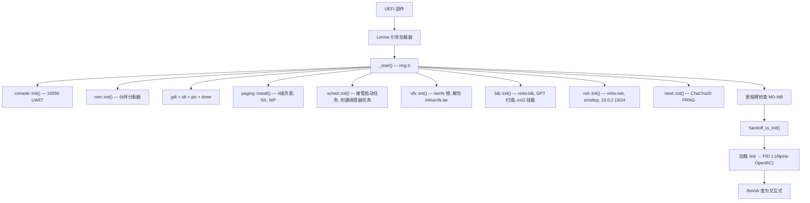
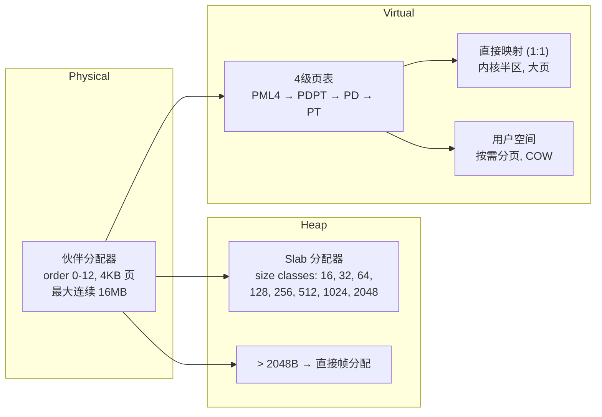

# MPOS

<div align="center">


**里程碑验证操作系统内核**

一个用 Rust 编写的最小化、经过里程碑式验证的操作系统内核，通过 Limine 协议引导。每个子系统在构建下一个之前都会被证明是正确的——从帧分配器到完整的交互式 Shell。兼容 Linux ABI：基于 musl 的二进制程序可直接运行。

[快速开始](#-快速开始) · [架构](#-架构) · [系统调用](#-系统调用) · [里程碑](#-里程碑) · [构建](#-构建) · [测试](#-测试) · [English](README.md)

</div>

---

## 概述

**MPOS** 是一个以**里程碑验证**为核心方法论构建的教学和研究型操作系统内核。与其渐进式地构建内核，MPOS 在构建每一层之前都会通过断言和主机端单元测试证明其正确性。

内核以 **Rust 库**（`src/lib.rs`）的形式组织，可在主机上进行单元测试（`cargo test --lib --target x86_64-unknown-linux-gnu`），而薄二进制入口（`src/main.rs`）则在 QEMU 上通过 M0 至 M14 的里程碑验证流程。

### 核心特性

| 特性 | 说明 |
|------|------|
| **里程碑验证** | 每个子系统在构建下一个之前都会被证明正确。串口日志携带标记（`M0_OK` 到 `M14_OK`），由测试框架断言验证。 |
| **主机可测试拆分** | 所有不涉及机器状态的代码都在库 crate 中，通过 `cargo test` 在主机上运行。机器相关代码位于 `#[cfg(target_os = "none")]` 之后。 |
| **Linux ABI 兼容** | 实现了约 225 个 Linux x86_64 系统调用。基于 musl 的程序（Alpine、busybox）可直接在内核上运行。 |
| **直写式 ext2** | 完整的可读写 ext2 实现，采用直写语义——无日志、无脏页追踪、崩溃即可见。 |
| **优先级调度器** | 四个优先级带（LOW、NORMAL、HIGH、CRITICAL）之间严格优先级，带内轮转调度，基于截止时间的休眠队列，COW fork，按需分页栈增长。 |
| **TCP/IP 网络** | 基于 smoltcp 的协议栈，支持 TCP、UDP、ICMP、ARP，运行在 virtio-net 上。仅支持 AF_INET——足以满足 musl DNS 解析器和 apk HTTP 通信。 |
| **交互式 Shell** | Alpine 的 ash shell，支持管道、重定向、环境变量、后台作业，以及可脚本化的 init。 |

---

## 架构

### 系统总览

```mermaid
graph TB
    subgraph UserSpace["用户空间 (Ring 3)"]
        MUSL["musl libc"]
        ASH["/bin/sh (ash)"]
        BUSYBOX["busybox 工具"]
        TESTS["60+ ABI 一致性测试"]
    end

    subgraph KernelSpace["内核空间 (Ring 0)"]
        subgraph SyscallGate["系统调用门 (~225 个 Linux x86_64 调用)"]
            SYSCALL["syscall / sysret"]
        end

        subgraph VFS["VFS 层"]
            VFS_CORE["Inode trait + 挂载表"]
            RAMFS["ramfs (initramfs, tmpfs)"]
            EXT2["ext2 (读写)"]
            DEVFS["devfs (/dev/null, tty, console, ...)"]
            PROCFS["procfs (/proc/meminfo, cmdline, ...)"]
            SYSFS["sysfs (/sys/class/block, ...)"]
            DEVPTS["devpts (/dev/pts/*)"]
            TTY["TTY (行规程)"]
            PIPE["pipe + socketpair"]
            SIGNALFD["signalfd / eventfd"]
        end

        subgraph Process["进程管理"]
            SCHED["调度器 (4级优先级 + RR)"]
            SIGNAL["信号处理"]
            FUTEX["Futex (wait/wake)"]
            FORK["fork / clone / execve"]
        end

        subgraph Memory["内存管理"]
            PMM["伙伴分配器 (order 0-12)"]
            SLAB["Slab 堆 (16-2048 字节)"]
            PAGE["4级页表 (W^X)"]
            COW["写时复制 fork"]
            ELF["ELF64 加载器"]
        end

        subgraph Drivers["设备驱动"]
            VBLK["virtio-blk"]
            VNET["virtio-net"]
            UART["16550 UART"]
            PCI_BUS["PCI 总线枚举"]
        end

        subgraph Net["网络"]
            SMOLTCP["smoltcp (TCP/UDP/ICMP/ARP)"]
            NETLINK["Netlink (rtnl)"]
        end
    end

    MUSL --> SYSCALL
    ASH --> MUSL
    BUSYBOX --> MUSL
    TESTS --> MUSL
    SYSCALL --> VFS_CORE
    SYSCALL --> SCHED
    SYSCALL --> SMOLTCP
    VFS_CORE --> RAMFS
    VFS_CORE --> EXT2
    VFS_CORE --> DEVFS
    EXT2 --> VBLK
    VNET --> SMOLTCP
    UART --> TTY
    SCHED --> PAGE
    FORK --> COW
```



### 启动流程



### 内存管理



### 网络数据路径


### 项目目录

```
mpos/
├── src/
│   ├── main.rs              # 二进制入口：_start → kernel_main → M0-M14
│   ├── lib.rs               # 库根（主机可测试）
│   ├── console.rs           # 内核控制台（dmesg 环形缓冲区、串口输出）
│   ├── binfmt.rs            # Shebang (#!) 脚本解释器
│   ├── rand.rs              # ChaCha20 PRNG（RDRAND + boot epoch）
│   ├── uevent.rs            # Netlink kobject uevent
│   │
│   ├── arch/x86_64/         # 架构相关代码
│   │   ├── context.rs       # 任务上下文切换（寄存器保存/恢复）
│   │   ├── critical.rs      # critical_section（cli/sti）
│   │   ├── gdt.rs           # 全局描述符表 + TSS
│   │   ├── idt.rs           # 中断处理（timer, BP, PF, syscall）
│   │   ├── paging.rs        # 4级页表、W^X、COW、AddressSpace
│   │   ├── pci.rs           # PCI 总线枚举
│   │   ├── pic.rs           # 8259 PIC（IRQ0→32, IRQ4→36）
│   │   ├── serial.rs        # 16550 UART（COM1, 中断驱动 RX）
│   │   ├── syscall.rs       # syscall/sysret 门（Ring 3 ↔ Ring 0）
│   │   ├── timer.rs         # PIT 100 Hz
│   │   ├── rtc.rs           # CMOS RTC（boot epoch 用于墙钟）
│   │   └── qemu.rs          # QEMU debug exit
│   │
│   ├── mm/                  # 内存管理
│   │   ├── pframe.rs        # 伙伴帧分配器（MAX_ORDER=12）
│   │   ├── heap.rs          # Slab 内核堆（size classes 16-2048）
│   │   ├── elf.rs           # ELF64 加载器（ET_EXEC + ET_DYN/PIE）
│   │   └── vm.rs            # 映射计划、KernelSections
│   │
│   ├── sched/               # 调度器
│   │   ├── policy.rs        # 优先级带、轮转调度、休眠队列
│   │   ├── runtime.rs       # 任务表（64 个槽位）、上下文切换、fork/exec
│   │   ├── signal.rs        # 信号编号、pending 位掩码、dispositions
│   │   └── futex.rs         # Futex wait/wake
│   │
│   ├── vfs/                 # 虚拟文件系统
│   │   ├── mod.rs           # Inode trait、FileSystem trait、路径解析
│   │   ├── file.rs          # 打开文件表（fd table）
│   │   ├── mount.rs         # 挂载表、Vfs struct、pivot_root
│   │   ├── ramfs.rs         # 内存文件系统
│   │   ├── ext2.rs          # 可读写 ext2（直写式）
│   │   ├── devfs.rs         # /dev/null、/dev/zero、/dev/tty、/dev/console 等
│   │   ├── devpts.rs        # /dev/pts/*（PTY）
│   │   ├── procfs.rs        # /proc（meminfo、mounts、cmdline、maps、fd 等）
│   │   ├── sysfs.rs         # /sys（块设备、uevent）
│   │   ├── tar.rs           # tar（ustar）解包器（initramfs 用）
│   │   ├── pipe.rs          # pipe + socketpair
│   │   ├── tty.rs           # TTY 行规程（规范模式、原始模式、转义键）
│   │   ├── termios.rs       # struct termios 默认值
│   │   ├── signalfd.rs      # signalfd
│   │   └── eventfd.rs       # eventfd
│   │
│   ├── syscall/             # 系统调用门
│   │   ├── mod.rs           # 错误码、cstr/argv 解析
│   │   └── linux/
│   │       ├── mod.rs       # 完整 Linux x86_64 分发表
│   │       ├── nr.rs        # 系统调用号常量
│   │       ├── fs.rs        # 文件相关系统调用
│   │       └── proc.rs      # 进程相关系统调用
│   │
│   ├── blk/                 # 块设备层
│   │   ├── mod.rs           # BlockDev trait
│   │   └── part.rs          # GPT/MBR 分区表扫描
│   │
│   ├── drivers/             # 设备驱动
│   │   ├── devices.rs       # 设备注册、uevent 发布
│   │   ├── pci.rs           # PCI 配置空间（mechanism 1）
│   │   ├── serial.rs        # 串口初始化、中断驱动读取
│   │   └── virtio/
│   │       ├── hal.rs       # VirtIO HAL（DMA、物理/虚拟地址转换）
│   │       ├── blk.rs       # VirtIO 块设备
│   │       └── net.rs       # VirtIO 网络设备
│   │
│   └── net/                 # 网络
│       ├── mod.rs           # smoltcp 协议栈、TCP/UDP/raw socket
│       ├── socket.rs        # Socket inode（AF_INET, AF_NETLINK）
│       └── rtnl.rs          # Route/netlink（ip 命令支持）
│
├── user/                    # 用户空间程序
│   ├── lib/lin.rs           # Linux ABI 测试框架 + syscall stubs
│   ├── bin/                 # 57 个 standalone 程序（no_std, ET_EXEC）
│   │   ├── hello.rs         # M12 示例程序
│   │   └── t_*.rs           # ABI 一致性测试（每个系统调用族一个）
│   └── src/bin/             # 7 个 musl 程序（std, rustix）
│       └── t_*.rs           # socket、rename、rmdir 测试
│
├── scripts/
│   ├── mkvm.sh               # 一键构建（内核 + 用户空间 + 磁盘镜像）
│   ├── run.sh               # QEMU 启动器（UEFI, virtio-blk, virtio-net）
│   ├── test.sh              # CI 流程（fmt, clippy, test, build, boot, assert）
│   ├── fetch-limine.sh      # 获取 Limine v9.6.7 引导加载器
│   └── cpio-extract.py      # CPIO 归档解压器

│
├── arch/x86_64/linker.ld    # 位置无关链接脚本
├── limine.conf              # 引导加载器配置
├── Cargo.toml               # 工作区根（内核 + user）
├── rust-toolchain.toml      # Nightly Rust、裸机目标
└── third_party/limine/      # Limine v9.6.7 二进制文件（gitignored）
```

### 设计原则

- **库/二进制拆分**：`src/lib.rs` 编译目标为 `x86_64-unknown-linux-gnu`（主机测试）；机器代码通过 `target_os = "none"` 门控。
- **共享系统调用表**：用户程序通过 `#[path]` 包含 `src/syscall/linux/nr.rs`——内核和用户空间不会在编号上产生分歧。
- **单处理器简单性**：所有共享状态使用 `critical_section::Mutex<RefCell<T>>`。锁下不睡眠、无自旋锁、无 per-CPU 数据。
- **伙伴分配器与侵入式空闲链表**：元数据从被管理内存中划出；通过空闲块中的双向链表实现 O(1) 合并。

---

## 系统调用

MPOS 实现了约 **225 个 Linux x86_64 系统调用**。POSIX 补全集(epoll、timerfd、*at 家族、身份、调度、内存建议)完全按 man 手册实现,每个标志值、结构布局和 errno 都由主机端测试钉死，与基于 musl 的程序二进制兼容。分发表位于 `src/syscall/linux/mod.rs`。

### 文件 I/O

| # | 名称 | 说明 |
|:-:|------|------|
| 0 | `read` | 从文件描述符读取 |
| 1 | `write` | 写入文件描述符 |
| 2 | `open` | 按路径打开文件 |
| 3 | `close` | 关闭文件描述符 |
| 4 | `stat` | 按路径 stat（旧版） |
| 5 | `fstat` | 按 fd stat |
| 6 | `lstat` | stat 符号链接本身（旧版） |
| 8 | `lseek` | 移动文件位置 |
| 17 | `pread64` | 在指定偏移读取（不移动 fd 位置） |
| 18 | `pwrite64` | 在指定偏移写入 |
| 19 | `readv` | 分散读 |
| 20 | `writev` | 分散写 |
| 21 | `access` | 检查路径可访问性 |
| 22 | `pipe` | 创建管道 |
| 23 | `select` | fd_set 式 I/O 多路复用 |
| 32 | `dup` | 复制 fd（最小空闲） |
| 33 | `dup2` | 复制 fd 到目标 |
| 40 | `sendfile` | 内核内部文件拷贝 |
| 72 | `fcntl` | 文件控制（F_DUPFD、F_GETFD、F_SETFD、F_GETFL、F_SETFL） |
| 73 | `flock` | 咨询文件锁（stub） |
| 74 | `fsync` | 刷新到存储 |
| 75 | `fdatasync` | 刷新数据（同 fsync） |
| 76 | `truncate` | 按路径截断文件 |
| 77 | `ftruncate` | 按 fd 截断文件 |
| 79 | `getcwd` | 获取当前工作目录 |
| 80 | `chdir` | 切换工作目录 |
| 81 | `fchdir` | 切换 cwd 到目录 fd |
| 82 | `rename` | 重命名路径（旧版） |
| 83 | `mkdir` | 创建目录（旧版） |
| 84 | `rmdir` | 删除空目录 |
| 85 | `creat` | 创建或清空文件 —— 1970 年代的写法 |
| 86 | `link` | 创建硬链接（返回 EPERM） |
| 87 | `unlink` | 删除文件（旧版） |
| 88 | `symlink` | 创建符号链接 |
| 89 | `readlink` | 读取符号链接目标 |
| 90 | `chmod` | 设置权限位（不强制执行） |
| 91 | `fchmod` | 按 fd 设置权限位 |
| 92 | `chown` | 设置所有者（不强制执行） |
| 93 | `fchown` | 按 fd 设置所有者 |
| 94 | `lchown` | 设置符号链接所有者 |
| 132 | `utime` | 设置时间戳,秒精度(旧式) |
| 133 | `mknod` | 创建设备/FIFO 节点 |
| 137 | `statfs` | 获取文件系统统计信息 |
| 138 | `fstatfs` | 按 fd 获取文件系统统计信息 |
| 162 | `sync` | 刷新脏数据（空操作） |
| 165 | `mount` | 挂载文件系统 |
| 166 | `umount2` | 卸载文件系统 |
| 187 | `readahead` | 预读提示(本内核积极读入:空操作) |
| 217 | `getdents64` | 读取目录条目 |
| 235 | `utimes` | 设置时间戳（旧版） |
| 257 | `openat` | 相对于 dirfd 打开 |
| 258 | `mkdirat` | 相对于 dirfd 创建目录 |
| 259 | `mknodat` | 相对 dirfd 创建节点 |
| 260 | `fchownat` | 相对于 dirfd 设置所有者 |
| 261 | `futimesat` | 相对 dirfd 设置时间戳 |
| 262 | `newfstatat` | 相对于 dirfd stat |
| 263 | `unlinkat` | 相对于 dirfd 删除文件 |
| 264 | `renameat` | 相对于 dirfds 重命名 |
| 265 | `linkat` | 相对于 dirfds 创建硬链接（返回 EPERM） |
| 266 | `symlinkat` | 相对于 dirfd 创建符号链接 |
| 267 | `readlinkat` | 相对于 dirfd 读取符号链接 |
| 268 | `fchmodat` | 相对 dirfd 设置权限位 |
| 269 | `faccessat` | 相对于 dirfd 检查可访问性 |
| 275 | `splice` | 在管道与文件之间搬移字节 |
| 280 | `utimensat` | 设置时间戳（纳秒精度） |
| 285 | `fallocate` | 预分配文件空间 |
| 292 | `dup3` | 带标志复制 fd |
| 293 | `pipe2` | 带标志创建管道 |
| 295 | `preadv` | 带偏移的矢量读 |
| 296 | `pwritev` | 带偏移的矢量写 |
| 306 | `syncfs` | 刷新一个描述符所在的文件系统 |
| 316 | `renameat2` | 带标志重命名 |
| 326 | `copy_file_range` | 内核内部跨文件复制 |
| 332 | `statx` | 扩展 stat |
| 437 | `openat2` | 以 struct open_how 打开(RESOLVE_*:EOPNOTSUPP) |

### 内存

| # | 名称 | 说明 |
|:-:|------|------|
| 9 | `mmap` | 映射内存（文件支持、匿名、MAP_FIXED） |
| 10 | `mprotect` | 更改页保护 |
| 11 | `munmap` | 取消内存映射 |
| 12 | `brk` | 更改程序断点 |
| 25 | `mremap` | 调整或移动映射 |
| 26 | `msync` | 同步文件映射(私有副本:空操作) |
| 28 | `madvise` | 内存建议（接受，空操作） |
| 149 | `mlock` | 锁定页(本已全部驻留) |

### 进程

| # | 名称 | 说明 |
|:-:|------|------|
| 39 | `getpid` | 获取进程（线程组）ID |
| 56 | `clone` | 创建进程或线程 |
| 57 | `fork` | fork 进程 |
| 58 | `vfork` | fork（同 fork） |
| 59 | `execve` | 执行程序 |
| 60 | `exit` | 终止线程 |
| 61 | `wait4` | 等待子进程退出 |
| 62 | `kill` | 发送信号 |
| 63 | `uname` | 获取系统信息（"mpos" 0.1.0） |
| 97 | `getrlimit` | 获取资源限制 |
| 98 | `getrusage` | 获取资源使用（返回零值） |
| 99 | `sysinfo` | 获取系统信息（运行时间、内存） |
| 100 | `times` | 获取 CPU 时间（时钟滴答） |
| 101 | `ptrace` | 进程跟踪（返回 EPERM） |
| 102 | `getuid` | 获取用户 ID（始终为 0） |
| 104 | `getgid` | 获取组 ID（始终为 0） |
| 105 | `setuid` | 设置用户 ID |
| 106 | `setgid` | 设置组 ID |
| 107 | `geteuid` | 获取有效 UID |
| 108 | `getegid` | 获取有效 GID |
| 109 | `setpgid` | 设置进程组 |
| 110 | `getppid` | 获取父进程 PID |
| 111 | `getpgrp` | 获取进程组 |
| 112 | `setsid` | 创建会话 |
| 113 | `setreuid` | 设置真实/有效 UID(仅 root) |
| 114 | `setregid` | 设置真实/有效 GID(仅 root) |
| 115 | `getgroups` | 获取补充组 |
| 116 | `setgroups` | 设置补充组 |
| 117 | `setresuid` | 设置真实/有效/保存 UID |
| 118 | `getresuid` | 获取真实/有效/保存 UID |
| 119 | `setresgid` | 设置真实/有效/保存 GID |
| 120 | `getresgid` | 获取真实/有效/保存 GID |
| 122 | `setfsuid` | 设置文件系统 UID(返回前值) |
| 123 | `setfsgid` | 设置文件系统 GID(返回前值) |
| 121 | `getpgid` | 获取进程的进程组 |
| 124 | `getsid` | 获取会话 ID |
| 125 | `capget` | 获取能力状态(root:全部许可) |
| 126 | `capset` | 设置能力状态 |
| 135 | `personality` | 执行域(查询 + PER_LINUX) |
| 140 | `getpriority` | 获取 nice 值(内核 20-nice 编码) |
| 141 | `setpriority` | 设置 nice 值(校验,不生效) |
| 155 | `pivot_root` | 切换根文件系统 |
| 157 | `prctl` | 进程控制（PR_GET_NAME 等） |
| 160 | `setrlimit` | 设置资源限制（接受） |
| 161 | `chroot` | 切换根目录 |
| 169 | `reboot` | 重启/关机 |
| 170 | `sethostname` | 设置主机名（接受，不存储） |
| 171 | `setdomainname` | 设置域名(procfs 存储) |
| 186 | `gettid` | 获取线程 ID |
| 200 | `tkill` | 向线程发送信号 |
| 234 | `tgkill` | 定向进程组中的一个线程发信号 |
| 201 | `time` | 获取 epoch 以来的秒数 |
| 231 | `exit_group` | 终止所有线程 |
| 247 | `waitid` | 等待子进程（siginfo_t） |
| 272 | `unshare` | 脱离命名空间(不存在:EOPNOTSUPP) |
| 273 | `set_robust_list` | 注册健壮 futex 列表 |
| 274 | `get_robust_list` | 获取健壮 futex 列表（返回 ENOSYS） |
| 309 | `getcpu` | 所在 CPU 与节点(单核,节点 0) |
| 317 | `seccomp` | 安全计算模式(ENOSYS;探测返回空) |
| 302 | `prlimit64` | 获取/设置资源限制 |
| 308 | `setns` | 加入命名空间(不存在:EINVAL) |
| 310 | `process_vm_readv` | 读另一进程内存 |
| 311 | `process_vm_writev` | 写另一进程内存 |
| 324 | `membarrier` | 内存屏障（单核上为空操作） |
| 334 | `rseq` | 注册可重启序列（接受） |

### 信号

| # | 名称 | 说明 |
|:-:|------|------|
| 13 | `rt_sigaction` | 获取/设置信号处置 |
| 14 | `rt_sigprocmask` | 获取/设置信号掩码 |
| 15 | `rt_sigreturn` | 从信号处理程序返回 |
| 34 | `pause` | 等待被捕获的信号(EINTR) |
| 128 | `rt_sigtimedwait` | 等待集合中的信号 |
| 129 | `rt_sigqueueinfo` | 附带 siginfo_t 的 kill(向非自身发 SI_USER:EPERM) |
| 130 | `rt_sigsuspend` | 换掩码并等待掩码外的信号 |
| 131 | `sigaltstack` | 获取/设置备用信号栈 |

### I/O 多路复用

| # | 名称 | 说明 |
|:-:|------|------|
| 7 | `poll` | 等待描述符就绪 |
| 23 | `select` | fd_set 式等待 |
| 270 | `pselect6` | select + 纳秒超时 + 信号掩码 |
| 271 | `ppoll` | poll + 纳秒超时 + 信号掩码 |
| 213 | `epoll_create` | 创建 epoll 实例(size 被忽略但须为正) |
| 232 | `epoll_wait` | 从兴趣表收集就绪条目 |
| 233 | `epoll_ctl` | 增改删兴趣表条目 |
| 281 | `epoll_pwait` | 带信号掩码的 epoll_wait |
| 291 | `epoll_create1` | 带标志创建 epoll 实例 |
| 441 | `epoll_pwait2` | timespec 超时版的 epoll_pwait |

### 时间与定时器

| # | 名称 | 说明 |
|:-:|------|------|
| 35 | `nanosleep` | 休眠 timespec 时长 |
| 36 | `getitimer` | 获取间隔定时器 |
| 37 | `alarm` | 一次性闹钟 |
| 38 | `setitimer` | 设置间隔定时器 |
| 96 | `gettimeofday` | 获取墙钟时间（timeval） |
| 164 | `settimeofday` | 设置墙上时钟(移动 RTC 锚点) |
| 228 | `clock_gettime` | 获取时钟（REALTIME、MONOTONIC、PROCESS_CPUTIME_ID） |
| 229 | `clock_getres` | 获取时钟分辨率 |
| 230 | `clock_nanosleep` | 带时钟规范的休眠 |
| 283 | `timerfd_create` | 以描述符报告的定时器 |
| 286 | `timerfd_settime` | 启停(ABSTIME、CANCEL_ON_SET) |
| 287 | `timerfd_gettime` | 剩余时间与间隔 |

### 调度

| # | 名称 | 说明 |
|:-:|------|------|
| 24 | `sched_yield` | 让出 CPU |
| 142 | `sched_setparam` | 设置调度参数(SCHED_OTHER:零) |
| 143 | `sched_getparam` | 获取调度参数 |
| 144 | `sched_setscheduler` | 设置策略(SCHED_OTHER;FIFO/RR:EOPNOTSUPP) |
| 145 | `sched_getscheduler` | 获取策略(恒为 SCHED_OTHER) |
| 146 | `sched_get_priority_max` | 策略的最高优先级(man 页表) |
| 147 | `sched_get_priority_min` | 策略的最低优先级 |
| 148 | `sched_rr_get_interval` | 轮转切片(timespec) |
| 314 | `sched_setattr` | 可扩展调度属性(设置) |
| 315 | `sched_getattr` | 可扩展调度属性(获取) |
| 158 | `arch_prctl` | 设置 FS/GS 基址（TLS） |
| 202 | `futex` | Futex wait/wake |
| 203 | `sched_setaffinity` | 设置 CPU 亲和性 |
| 204 | `sched_getaffinity` | 获取 CPU 亲和性 |
| 218 | `set_tid_address` | 设置 clear-tid 地址 |

### 设备 I/O

| # | 名称 | 说明 |
|:-:|------|------|
| 16 | `ioctl` | 设备控制（TIOCGWINSZ、TCGETS、BLKGETSIZE64 等） |
| 221 | `fadvise64` | 建议提示（接受，空操作） |

### 网络

| # | 名称 | 说明 |
|:-:|------|------|
| 41 | `socket` | 创建 socket（AF_INET：SOCK_STREAM、SOCK_DGRAM） |
| 42 | `connect` | 连接 socket |
| 43 | `accept` | 接受连接 |
| 44 | `sendto` | 发送数据 |
| 45 | `recvfrom` | 接收数据 |
| 46 | `sendmsg` | 带辅助数据发送 |
| 47 | `recvmsg` | 带辅助数据接收 |
| 48 | `shutdown` | 关闭 socket |
| 49 | `bind` | 绑定到地址 |
| 50 | `listen` | 标记为被动 |
| 51 | `getsockname` | 获取本地地址 |
| 52 | `getpeername` | 获取远程地址 |
| 53 | `socketpair` | 创建 socket 对 |
| 54 | `setsockopt` | 设置 socket 选项 |
| 55 | `getsockopt` | 获取 socket 选项 |
| 288 | `accept4` | 带标志的 accept(随后 EOPNOTSUPP:无 TCP accept) |
| 299 | `recvmmsg` | 收多条消息,带超时 |
| 307 | `sendmmsg` | 发多条消息 |

### 杂项 / Stub

| # | 名称 | 说明 |
|:-:|------|------|
| 95 | `umask` | 获取/设置文件创建掩码（不强制执行） |
| 103 | `syslog` | 内核日志环,klogctl 0-10 型 |
| 153 | `vhangup` | 虚拟挂起终端(空操作) |
| 282 | `signalfd` | 创建信号 fd |
| 289 | `signalfd4` | 带标志创建信号 fd |
| 290 | `eventfd` | 创建事件计数 fd |

---

## 里程碑

每个里程碑在构建下一个子系统之前证明当前子系统正确。

| 里程碑 | 子系统 | 验证内容 |
|:------:|--------|---------|
| **M0** | 分配器 | 全局堆分配器端到端工作（Vec、String） |
| **M1** | 中断 | 时钟以正确频率滴答；断点异常可捕获 |
| **M2** | 帧与堆 | 伙伴分配器分出不重叠的块；Slab 堆满足所有布局 |
| **M3** | 分页 | 内核运行在自己的页表上；W^X 验证；进程获得独立地址空间 |
| **M4** | 调度器 | 轮转调度、抢占、休眠、空闲、基于优先级的核窃取 |
| **M6** | 系统调用 | `syscall` 门正确分发；fd 检查工作；通过 dispatch 的 exit 结束任务 |
| **M7** | VFS | ramfs 根、挂载子文件系统、通过 fd 表的多任务文件 I/O |
| **M8** | Initramfs 与 devfs | tar 解包、`/dev/tty`、`/dev/console`、`/dev/null`、`/dev/zero` |
| **M9** | 进程 | ELF 加载到新地址空间；进入 Ring 3；退出码往返验证 |
| **M10** | 块设备与 ext2 | virtio-blk 检测；ext2 挂载、读取、写入、冷挂载验证 |
| **M11** | 管道、TTY、信号 | 管道字节传输和 EOF；TTY 行编辑；SIGTERM、SIGKILL、kill(0) |
| **M12** | Shell 与核心工具 | Shell、echo、cat、ls、true、false、sleep —— 全部运行在 Ring 3 |
| **M13** | Init 移交 | `/sbin/init` 成为 PID 1；Shell 通过 UART 中断变为交互式 |
| **M14** | 退出状态 | Shell `$?` 携带上一条命令的退出码 |

---

## 快速开始

### 前置条件

- **Rust nightly**（包含 `rust-src`、`rustfmt`、`clippy`）
- **QEMU**（x86_64 或 aarch64）
- **OVMF** —— QEMU 用它替代 SeaBIOS 的 UEFI 固件（`/usr/share/OVMF/x64/OVMF_CODE.4m.fd`）
- **python3** —— `scripts/mkfat.py` 无需 loop 设备即可写出 FAT32 卷
- **parted** —— 划分镜像的 GPT 分区表
- **mke2fs** / **e2fsprogs** —— 创建 ext2 数据分区

```bash
rustup toolchain install nightly
rustup component add rust-src rustfmt clippy --toolchain nightly
rustup target add x86_64-unknown-none aarch64-unknown-none --toolchain nightly
```

### 构建并运行

```bash
# 1. 获取 Limine 引导加载器（仅需一次）
./scripts/fetch-limine.sh

# 2. 构建内核、用户程序和可引导磁盘镜像
./scripts/mkdisk.sh

# 3. 在 QEMU 中启动
./scripts/run.sh
```

内核将启动，运行 M0–M14 里程碑验证，然后进入交互式 Shell。

---

## 构建

### 仅构建内核

```bash
cargo build --target x86_64-unknown-none
```

### 完整磁盘镜像

```bash
./scripts/mkdisk.sh
```

构建所有内容并组装 4 分区 GPT 磁盘镜像 `build/linux-x86_64.img`：

| 分区 | 类型 | 内容 |
|------|------|------|
| 1, `ESP` | FAT32, 34 MiB | `EFI/BOOT/BOOTX64.EFI`（Limine）、`limine.conf` |
| 2, `Boot` | FAT32, 192 MiB | `mpos.elf`、`initramfs.tar` |
| 3, `Root` | ext2, 384 MiB | Alpine Linux rootfs（OpenRC、musl、busybox、apk） |
| 4, `Data` | ext2, 8 MiB | 种子文件（用于测试的文本文档） |

QEMU 直接在 OVMF 下启动——不需要 ISO、不需要光驱、宿主上也不需要 loop 设备。FAT32 卷由 `scripts/mkfat.py` 逐字节写出。

### 交叉架构

```bash
ARCH=aarch64 ./scripts/run.sh
```

aarch64 支持正在开发中——目前内核 ELF 可以构建，但启动流程尚未完成。

---

## 测试

### 主机端单元测试

```bash
cargo test --lib --target x86_64-unknown-linux-gnu
```

测试调度器策略、Shell 解析器、VFS 路径解析等架构无关代码。

### 完整 CI 流程

```bash
./scripts/test.sh
```

运行：

1. `cargo fmt --check`
2. `cargo clippy`（内核和主机目标）
3. `cargo test --lib`（主机）
4. 通过 `mkdisk.sh` 构建
5. 在 QEMU 中启动并捕获串口日志
6. 断言里程碑标记（`M0_OK` 到 `M14_OK`、`APK_OK`）
7. 检查 `KERNEL PANIC` 或 `INIT_EXITED`

### 用户程序

**60+ ABI 一致性测试**验证 Linux 系统调用接口：

| 类别 | 测试 |
|------|------|
| **文件 I/O** | `t_read`、`t_write`、`t_openat`、`t_close`、`t_fstat`、`t_newfstatat`、`t_statx`、`t_lseek`、`t_readlink`、`t_getdents64`、`t_unlinkat`、`t_mkdirat`、`t_renameat2`、`t_pipe2`、`t_dup`、`t_dup2`、`t_dup3`、`t_fcntl`、`t_access`、`t_faccessat`、`t_mmap`、`t_munmap`、`t_mprotect`、`t_mremap`、`t_brk`、`t_readv`、`t_writev` |
| **进程** | `t_fork`、`t_clone`、`t_execve`、`t_exit_group`、`t_wait4`、`t_kill`、`t_getpid`、`t_gettid`、`t_getppid`、`t_prlimit64`、`t_uname`、`t_arch_prctl`、`t_rseq`、`t_set_robust_list`、`t_set_tid_address`、`t_sched_getaffinity` |
| **信号** | `t_rt_sigaction`、`t_rt_sigprocmask`、`t_sigaltstack` |
| **内存** | `t_mmap`、`t_munmap`、`t_mprotect`、`t_mremap`、`t_brk`、`t_madvise` |
| **时间** | `t_clock_gettime`、`t_nanosleep` |
| **网络** | `t_socket`、`t_socketpair`、`t_sockopt`、`t_tcp`、`t_udp` |
| **杂项** | `t_futex`、`t_getrandom`、`t_poll`、`t_ioctl`、`t_rename`、`t_rmdir`、`t_chdir`、`t_getcwd` |

测试以两种方式编译：standalone `no_std` 二进制（通过 `rustc`）和 musl 二进制（通过 Cargo + `rustix`）。

---

## 设计说明

### 单处理器模型

MPOS 运行在单核上。所有共享状态由 `critical_section::Mutex<RefCell<T>>` 保护（中断禁用 = 互斥）。`spin::Mutex` 被刻意不使用——在被抢占的任务上忙等会导致死锁。

### COW Fork

父子进程间共享的页被标记为只读，使用 COW 位（PTE bit 9）。缺页处理程序分配新帧、复制内容，并在首次写入时重新映射为可写。伙伴分配器中的引用计数跟踪共享帧。

### 按需分页栈增长

用户栈从 16 页（64 KiB）开始，在缺页时增长，上限为 `USER_STACK_MAX = 8 MiB` 和 `STACK_GROWTH_SLACK = 64 KiB`。缺页处理程序检查当前栈限制，如果在范围内则映射新页。

### 直写式 ext2

每次 `write_at()` 都立即通过块缓存刷新。无日志、无脏页追踪、无后台回写。简单但正确——崩溃即可见。

### 信号模型

信号被记录但不作为处理程序传递（用户栈上没有信号帧）。每个信号默认是致命的——进程被终止，而不是被调用。`SIGKILL` 和 `SIGSTOP` 无法被阻止。

---

## 许可证

本项目基于 [MIT 许可证](LICENSE) 授权。

---

<div align="center">
<sub>用 Rust 构建——逐个里程碑地证明正确。</sub>
</div>
