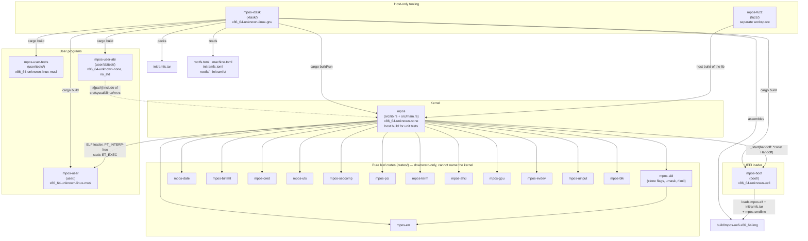
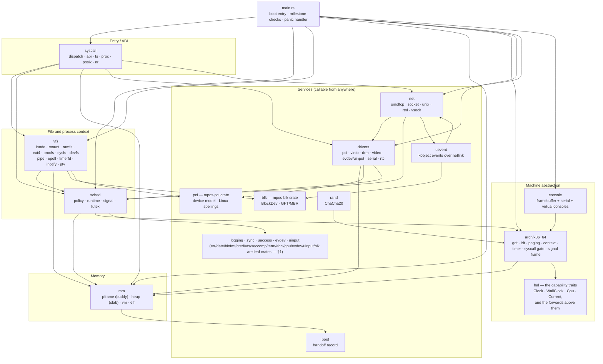
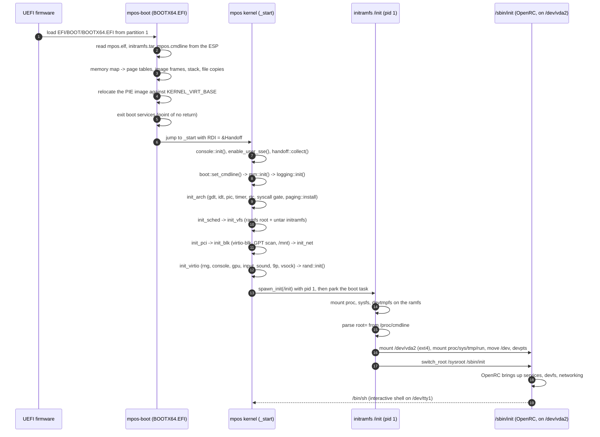
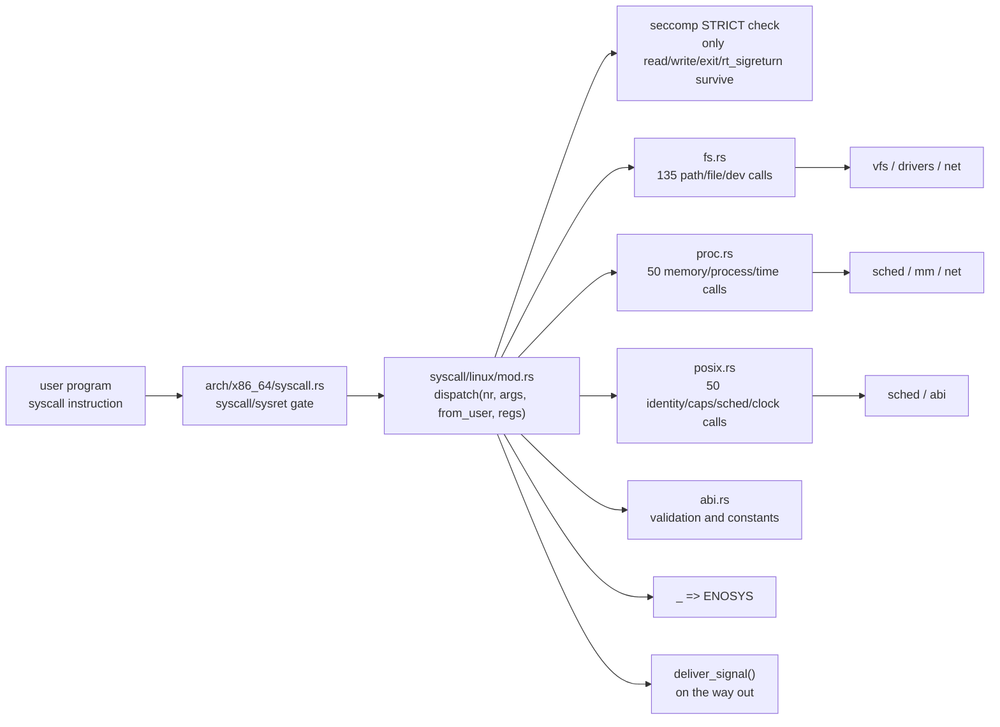

# MPOS Architecture

How the pieces fit together, which way the arrows point, and where they currently
point the wrong way.

This file is descriptive, not aspirational: every edge in §2 and §6 was read out of
the source (`crate::` references, `use` statements and module declarations), not
drawn from intent. Where the code and the intended layering disagree, §8 says so and
`NOTES.md` (Phase 11) carries the remediation plan.

- [1. The repository as crates](#1-the-repository-as-crates)
- [2. The kernel module graph](#2-the-kernel-module-graph)
- [3. What each layer owns](#3-what-each-layer-owns)
- [4. Boot and handoff](#4-boot-and-handoff)
- [5. The syscall path](#5-the-syscall-path)
- [6. Measured edges and cycles](#6-measured-edges-and-cycles)
- [7. Concurrency model](#7-concurrency-model)
- [8. Target gating and host testability](#8-target-gating-and-host-testability)
- [9. Known layering violations](#9-known-layering-violations)

---

## 1. The repository as crates

One Cargo workspace, five program members, a group of pure leaf crates under
`crates/`, plus one separate workspace. `default-members = ["."]`
in the root `Cargo.toml` means plain `cargo build` / `cargo test` / `cargo clippy` still
mean "the kernel", exactly as the old shell scripts assumed.



Two notes on the graph, then the leaf crates.

**`mpos-boot` does not depend on `mpos`.** They are separate compilations that agree on a
hand-written ABI: a `#[repr(C)]` record in `RDI` at `_start`, with its magic number and the
boot-stack canary. The record itself is one definition — the `mpos-bootinfo` leaf, which both
`mpos-boot` and the kernel depend on — so its layout is written once and checked by
`HANDOFF_MAGIC`. There is still no crate between the two *binaries* (the loader cannot link the
`no_std` kernel, built for a different target), and the canary in `src/board/x86_64.rs` is still spelled
on both sides; the record is not.

**`mpos-user-abi` reaches into kernel source.** Each test program does
`#[path = "../../../lib/lin.rs"]`, and `lin.rs` in turn does
`#[path = "../../../src/syscall/linux/nr.rs"]`. This is the one intentional source-level edge
from userland into the kernel, and it exists for one reason: kernel and tests cannot
disagree about a syscall number without one of them failing to build.

**The fuzz crate is its own workspace.** `fuzz/Cargo.toml` declares `[workspace]` so that
`cargo fuzz` can pick `x86_64-unknown-linux-gnu` over the root `.cargo/config.toml`'s
bare-metal default. It depends on `mpos` with `default-features = false`, i.e. it fuzzes
exactly the part of the kernel that `src/lib.rs` leaves ungated.

**Thirteen pure leaves are their own crates under `crates/`.** Each depends on
nothing in the kernel (only `core`/`alloc`, and `critical-section` for
`pci`/`uts`/`term`/`gpu`/`blk`; `mpos-uinput` depends on `mpos-evdev` for one constant), so they were extracted as workspace members and
re-exported from `src/lib.rs` under their old names (`pub use mpos_err as err;`).
The call sites are unchanged; what the crate boundary buys is enforcement, not
tidiness — a leaf crate physically cannot write `crate::sched::…`, so the
downward-only rule that `§9` keeps having to re-audit is now a compile error
rather than a convention. The first seven (`err`, `date`, `binfmt`, `cred`,
`uts`, `seccomp`, `pci`) were chosen because they already sat *outside* the
module graph's one strongly-connected component (`§6`); the next ones were
chosen for the same reason plus a placement one — `term` (the terminal emulator:
a cell grid is not a filesystem fact, V-4), `ahci` (the port decode: arithmetic
whose only reader is machine-only), `gpu` (the wire ABI, the DRM blobs, the cursor
blend and the sync-object state machine) and the input policy pair `evdev`/`uinput`
(which of a device's readers sees which record, and the request vocabulary a program
declares a device with). `mpos-gpu` is the interesting
one: it was *inside* the component by a single edge — `sync.rs` woke a parked
waiter by calling `sched::wake` — and the split is what forced that seam to
become a parameter (`gpu::sync::Waker`, injected by `drivers/drm` and by a
recording test), which is also why the wake is host-testable for the first time.
`blk` is the most recent: the `BlockDev` contract, the disk registry and the
GPT/MBR decode were already host-tested inside `src/blk`, and extracting them
removed the module's one upward-ish reference — `part.rs` sized its transfer
buffer from `mm::PAGE_SIZE`, so the bound now lives with the trait that states
it (`mpos_blk::PAGE_SIZE`), as a leaf that cannot name the kernel must.
Anything still inside that component stays inside `mpos` until Phase 11 breaks
the cycles; `fuzz/` may later depend on these crates directly instead of through
`mpos`.

---

## 2. The kernel module graph

The picture below is the **intended** shape: a strict one-way stack, with devices, PCI, the
RNG, uevents and the block layer as services that anyone may call. Every arrow is a real
`crate::` reference in the source.



Read it as "may call", not "calls on every path": `net` names `sched` because blocking
socket calls park in the scheduler, and `drivers` names `sched` because a driver's service
task is a scheduler task.

**`hal` is the machine seam.** `arch/src/hal/mod.rs` declares the capability traits every machine
implements (`Clock`, `WallClock`, `Cpu`, `Interrupts`, `Paging`, `Contexts`, the last three with
associated types), an `Entropy` concern for the machine's seed sources, the platform tag `Current`, and a handful of *optional capability* traits
(`Msi`, `FpuTrap`, `SignalFrame`) for the ways one machine does something another has no hardware
for — message-signalled delivery, the x87 lazy-FPU `#NM` trap protocol, segment selectors. Each
`arch/src/arch/<arch>/mod.rs` implements the six baseline concerns *for* `Current`, and only the
capabilities its hardware actually has, so `arch → hal` is the only arrow between the two and
everything above the machine layer calls `crate::hal`'s forwards rather than naming `arch` — which
makes `arch/src/arch/mod.rs` a facade of four items and its submodules `pub(crate)`. An absent
capability is *absent* (the aarch64 `Current` simply is not an `Msi`/`FpuTrap`; it is a
`SignalFrame` since §13.2's Stage 3b, with its own `rt_sigframe`), not a
method every machine must fake an answer for (`AGENTS.md` §3 rule 4). Which capabilities a build has is
a `mpos_*` flag declared per target in `.cargo/config.toml` (beside each machine's linker script, listed
for `check-cfg` in `Cargo.toml`), so the forwards' `#[cfg]` gates name the capability and never the
architecture — `arch/src/hal/mod.rs` contains no machine name at all (`NOTES.md` §13.1). The register ABI — the
`syscall` gate, the trap frame, `user_regs_struct` — is per-arch *by definition* and stays in
`arch/`; wrapping it in a neutral type would be the private dialect rule 3 forbids, so a port writes
`arch/<arch>/` and edits no shared file (`NOTES.md` §9.1).

**Honest caveat:** several boxes above are *not* one-way in the code. §6 lists the measured
differences — in particular `drivers → syscall`, `sched → vfs`/`net`/`drivers`,
`console → vfs` and the whole `vfs ↔ sched ↔ syscall ↔ net` cluster. Those are real edges
today; §9 explains what they are.

The leaf crates of §1 are deliberately *not* drawn into this graph's SCC: they are the
parts already outside it. `err`, `date`, `binfmt`, `cred`, `uts`, `seccomp`, `pci` and `blk`
depend only downward (on `core`/`alloc`, and `critical-section` for `pci`/`uts`/`blk`), so the
"may call" arrows into them are all that exist and none point back. Splitting them out changed
no edge in this picture — it made them un-buildable-in-reverse by the compiler. `drivers → pci`
and `drivers`/`uevent`/`vfs → blk` remain (the driver finds devices, the crate describes them);
they are cross-crate edges.

---

## 3. What each layer owns

| Layer | Module | Owns | Must not |
|---|---|---|---|
| Entry | `src/main.rs` | The one architecture-independent entry (`_start`, which takes the loader's record in the platform's first argument register and hands the machine its callbacks) and the one panic handler (the machine's wire, the machine's context dump, stop). Established a machine by `mpos_arch::arch::boot` on x86_64 and aarch64 alike | Contain reusable logic — everything reusable lives in the lib so the host can test it. Name no machine: the bring-up is `arch`'s, so nothing here is `#[cfg]`-ed |
| Board | `src/board/<arch>.rs` | What only a machine can answer: its boot wiring (`milestone`, `devices`, `init`), its devices, its milestone checks, the boot-stack canary check on x86_64, and the panic context dump | Be entered by more than one path — `src/board/mod.rs` picks the body in one place, exactly as `arch/src/arch/mod.rs` does for the library. Nothing here is machine *layer*: the entry, tables, pages and wire are `mpos-arch`'s (`NOTES.md` §14.8) |
| Machine | `arch/src/arch/x86_64/` | GDT/IDT/TSS, PIC and LAPIC, 4-level paging, context switch, the `syscall`/`sysret` gate, the PIT, port I/O | Be named from outside `arch::`/`hal::` — the submodules are `pub(crate)` behind `arch/mod.rs`'s four-item facade, and the depgraph fails on any module but `arch`/`hal`/`main`/`lib` naming it. The register ABI the syscall gate and trap frame carry is per-arch by definition and stays here |
| HAL | `arch/src/hal/` | The capability traits every machine implements (`Clock`, `WallClock`, `Cpu`, `Interrupts`, `Paging`, `Contexts`, `Console`, `Entropy`) with their associated types, the optional capability traits only some machines have (`Msi`, `SerialRing`, `FpuTrap`, `SignalFrame`), the platform tag `Current`, and the one-line forwards everything above calls | Hold machine logic: the `impl`s live in `arch/<arch>/`, so a port adds them there without editing a shared file. It is not `drivers::virtio::hal` (that is `virtio_drivers`' own `Hal`), and it is one trait per concern — not one per function — the baseline concerns every machine has plus optional capabilities a machine implements only if its hardware has them (`NOTES.md` §11.3) |
| Memory | `src/mm/` | Buddy frame allocator (order 0–12), slab heap (16–2048 B), mapping plans, the ELF64 loader | Know about files, tasks or devices |
| Scheduler | `src/sched/` | The 64-slot task table, priority bands + round-robin, sleep/block deadlines, signal state, futex | Be the place where a subsystem's per-process cleanup lives (see V-3) |
| VFS | `src/vfs/` | The `Inode`/`FileSystem` traits, mounts and path resolution, the fd table, every filesystem (ramfs, ext2/ext4, procfs, sysfs, devfs, devpts, p9, tmpfs), pipes, epoll, timerfd, eventfd, signalfd, inotify, locks, memfd/dmabuf | Contain the terminal emulator — that is the `term` leaf crate now, and the VC vocabulary/`vtmode`/active-console number moved there too (V-4 closed); the console mux stays here with the pty/tty nodes it orchestrates |
| Networking | `src/net/` | smoltcp integration, the socket registry and its handles, AF_INET/AF_UNIX/AF_NETLINK/AF_VSOCK, netlink route writes | Reach up into `syscall` to validate a user pointer (it borrows the `crate::uaccess` leaf — see V-9, closed by B3). It holds the machine's adapter and vsock device as `Arc<dyn drivers::virtio::{NetDevice, VsockDevice}>` and never the transport, so the stack names no PCI/MMIO and a machine whose card is MMIO runs the same code (`NOTES.md` §13.4) |
| Drivers | `src/drivers/` | virtio (blk, net, gpu, input, console, rng, sound, 9p, vsock, MSI-X) plus the transport-neutral contracts `NetDevice`/`VsockDevice` the stack above holds (one impl per transport - virtio-PCI for x86_64, virtio-MMIO for aarch64, both landed), DRM/KMS, the render task, evdev/uinput, PCI config space, the x86_64 serial console, the console's transmit queue (`tx_ring`, shared by both machines' UARTs), the RTC, the QEMU debug-exit port | Parse a device's ioctl ABI (that is `syscall/linux/fs/ioctl.rs` today — see V-2) |
| Console | `src/console.rs` | Log ring, serial output, the switch to the framebuffer, the six virtual consoles | Reach into the VFS for the grid — it names the `term` *crate* now, never `vfs::term` (V-4 closed: the `vfs ↔ console` pair is broken). The wire and its transmit ring are reached through `crate::hal`'s `Console`/`SerialRing` forwards, not by naming `drivers::serial`; on a machine with no ring the queue-and-park and framebuffer arms are `#[cfg]`-inert, so it compiles on a polled sink. Both machines are `SerialRing`s now (§13.7) and drain *one* queue - `drivers::tx_ring`, behind a three-method `Transmitter` - so the console's decision about who parks was written once rather than once per UART |
| ABI | `src/syscall/` | Numbers (`nr.rs`), pure ABI facts and argument validation (`abi.rs`), the dispatch table, and the handlers (`fs/file.rs` + `fs/ioctl.rs`, `proc.rs`, `posix.rs`) | Grow past the point where one file is a device-ioctl switchboard (see V-2) |
| Services | `crates/err`, `crates/pci`, `crates/date`, `crates/binfmt`, `crates/cred`, `crates/uts`, `crates/seccomp`, `crates/term`, `crates/ahci`, `crates/gpu`, `crates/evdev`, `crates/uinput`, `crates/blk` (leaf crates — §1); `src/rand.rs`, `src/uevent.rs`, `src/logging.rs`, `src/sync/`, `src/uaccess.rs` | One concern each, host-compiled where the logic is pure. The thirteen leaf crates depend only downward and cannot name the kernel — the split is the enforcement. `err` is the errno table itself: a leaf of constants every layer may answer with, so refusing in Linux's language never means naming `syscall` from below. `uaccess` is the userland-boundary leaf (`buffer_ok`/`user_accessible`/`MAX_IO`/`err_of`): a layer below `syscall` validates a caller's pointer and maps a `VfsError` without reaching up into the ABI layer | — |

**How this table is enforced, not just drawn.** A module may call **downward only**, into what §2
draws; anything else is a violation. The graph is *measured*: `cargo xtask depgraph` (a host test
too) re-extracts every `crate::` reference and fails when an edge appears that was not recorded the
last time someone set the number — adding an edge along a violation (§9's V-*) is a red gate, and
removing one lowers a constant. Two rules make the table usable rather than decorative: an existing
violation is not precedent — code may not add a *new* caller along a violation edge or widen one;
and a needed edge changes the design record first — a legitimate dependency genuinely missing from
§2 is added here (§2 + §3) *in the same commit*, with the reason, because a diff that contradicts
the graph is the diff that is wrong. `AGENTS.md` carries the working copy of these rules and points
here for the table itself; the two files move together.

---

## 4. Boot and handoff



Details worth knowing:

- **`_start` reaches the kernel already in long mode, ring 0, on a stack the loader mapped.**
  `src/boot/handoff.rs::collect` validates the record rather than trusting it; a wrong `RDI`
  is a panic, not a wild read.
- **The kernel mounts nothing but its own root.** `/proc`, `/sys`, `/dev`, the real root and
  `pivot_root` are all done by the initramfs's `/init`, because a kernel that assembles them
  first leaves the pieces an owner of the system cannot unmount. See `initramfs/init`.
- **The boot stack has a canary.** The loader plants one, and `check_boot_stack()` in
  `src/board/x86_64.rs` verifies it twice — before the handoff and again after `spawn_init`, which is
  the deepest call the boot task ever makes.
- **Boot words on the command line** (`mpos.cmdline`, or QEMU-generated): `console=` names the
  consoles the kernel's log goes to —
  `console=ttyS0` the serial wire, `console=tty0` the virtual console on the framebuffer. The
  parameter may be repeated, output goes to every console named, and the last is the preferred
  one; a value naming a console this kernel does not have is reported and ignored. There is no
  word for *how the machine was launched*, because that is not a fact about the machine: a
  QEMU booted without a window still has a virtio-gpu and still reports a display mode, so
  only the command line can say whether the framebuffer console is one of the consoles. The word
  the kernel used to read to decide whether to run its own checks (`mpos.selftest`) is gone from it:
  that is a build now, so the kernel reads `console=` and nothing about how it was launched
  (`docs/NOTES.md` §15.19).
  `cargo xtask run --mode terminal|gui|mirror` picks the list — one word per machine:
  the wire alone, the framebuffer alone (`gui`: the text console shows in the window and
  the launcher reads the wire from `build/serial.log` instead of stdio), or the two with
  the framebuffer preferred (`src/boot/console_list.rs` reads it, `xtask/src/config.rs`
  writes it), and a compositor's
  claim on the scanout is arbitrated at runtime through the DRM master and `KDSETMODE`
  (`src/vfs/vcmux.rs`), never at boot.

---

## 5. The syscall path



The routing counts come from the dispatch table itself and are worth stating because they
explain the file sizes: `fs.rs` carries every path-carrying call *and* every per-device ioctl,
which is why it is the second-largest file in the tree. `NOTES.md` Phase 11 (item B) proposes
moving the device ioctl contracts down into the drivers.

The one unusual return path is `deliver_signal`, called on the way out of every syscall: if a
signal became deliverable, the handler rewrites the task's register frame wholesale so the
return lands in the user's handler instead of the interrupted instruction.

---

## 6. Measured edges and cycles

Extracted from all of `src/**/*.rs` by matching `crate::<module>` on every file and mapping
each file to its top-level module. Weight = number of references; "e.g." names one file that
carries the edge. Self-edges (a module's own files) are excluded.

| From | To | W | Example carrier |
|---|---|---:|---|
| arch | mm | 4 | `arch/x86_64/idt.rs` |
| arch | boot, console, date, drivers, net, sched, syscall | 1 each | `arch/x86_64/paging.rs`, `idt.rs`, `rtc.rs`, `syscall.rs` |
| blk | mm | 1 | `blk/part.rs` |
| console | arch, drivers, sched, vfs | 1 each | `console.rs` |
| drivers | arch 7, mm 6, sched 7, vfs 11, console 3, blk 2, evdev 2, uevent 2, uinput 2, net 1, pci 1, rand 1, syscall 1, date 1 | 48 | `drivers/devices.rs`, `drivers/drm.rs` |
| evdev | sched, vfs | 1 each | `evdev.rs` |
| logging | arch, boot, console | 1 each | `logging.rs` |
| main | sched, syscall | 1 each | `main.rs` |
| mm | arch 1, boot 3 | 4 | `mm/mod.rs` |
| net | sched 5, syscall 5, vfs 4, arch 3, drivers 3, uevent 2 | 22 | `net/mod.rs`, `net/socket.rs` |
| pci | drivers | 1 | `pci.rs` |
| rand | arch, drivers | 1 each | `rand.rs` |
| sched | syscall 3, mm 2, arch, binfmt, drivers, net, rand, vfs | 11 | `sched/runtime.rs`, `sched/futex.rs` |
| syscall | sched 6, vfs 5, arch 4, drivers 2, mm 2, net 2, console, rand, uinput | 24 | `syscall/linux/mod.rs`, `fs.rs` |
| uevent | blk, net | 1 each | `uevent.rs` |
| uinput | evdev | 1 | `uinput.rs` |
| vfs | sched 15, arch 5, drivers 5, blk 4, mm 4, console 3, uevent 3, net 2, pci 2, syscall 2, boot 1, rand 1 | 47 | `vfs/epoll.rs`, `vfs/devfs.rs`, `vfs/procfs.rs` |

**Mutual pairs (a cycle of length two, at module granularity):**

```
arch     <-> console      arch     <-> drivers     arch     <-> mm
arch     <-> net          arch     <-> sched       arch     <-> syscall
console  <-> drivers      console  <-> vfs         drivers  <-> net
drivers  <-> pci          drivers  <-> rand        drivers  <-> sched
drivers  <-> syscall      drivers  <-> vfs         net      <-> sched
net      <-> syscall      net      <-> uevent      net      <-> vfs
sched    <-> syscall      sched    <-> vfs         syscall  <-> vfs
```

That is 21 pairs among the eleven modules that appear in one (`arch`, `console`, `drivers`, `mm`,
`net`, `pci`, `rand`, `sched`, `syscall`, `vfs`, `uevent`). The module graph is, at this
granularity, one strongly connected component: **there is no layer that can be compiled, tested
or refactored in isolation.** §9 breaks the number down by cause; `NOTES.md` Phase 11 has the plan.

Two notes on the table above, both of them about trusting a measured number:

- It was measured **before Step A**, which deleted three files from `arch/x86_64`. One of them
  mattered to this list: `arch/x86_64/serial.rs` was never compiled - it was not declared in
  `arch/x86_64/mod.rs` - and the extraction reads files rather than builds, so the byte it
  contributed made `arch <-> vfs` a pair. `arch` no longer names `vfs` at all, which is why that
  row and that pair are gone above; the other twenty-one are real.
- The list used to be printed under a count of *23* "of the 25 possible". The list had 22 entries;
  the count was one too high and the denominator was never defined. `NOTES.md` §11.0 now carries
  the re-measured figures and names what participates, so the number and its scope arrive
  together.
- Re-measured at the AF_PACKET/sound landing (the commit that added V-13 and the `err` module),
  the weights above are stale in both directions. **Gone:** `pci→drivers` (the only remaining
  mention is a doc comment) and `evdev→vfs` — dropping `drivers↔pci` leaves 20 mutual pairs.
  **Much wider than the rows say:** `drivers→vfs` is 72 refs across ten carrier files (the row
  names two), `arch→sched` is 26, `syscall→console` is 6. **Real but never drawn in §2:**
  `sched→seccomp` (12), `syscall→seccomp` (5), `console→boot` (1). **Removed by that commit:**
  `uevent→syscall` (the errno table now lives at the crate root as `crate::err`, which cost
  ~110 below-`syscall` constant refs their upward edge across `net`, `sched`, `vfs`, `uevent`
  and `sound`) and `uevent→sched` (credentials are assembled by `net::socket::task_identity`,
  an allowed edge, and `bind` takes the preferred port id as a parameter). The SCC verdict
  stands: the remaining edges still make the module graph one component at this granularity.

**The ratchet is the live measurement.** `cargo xtask depgraph` (`NOTES.md` §11.2 Step G) runs the
same extraction as its own *check*, with one difference that matters: `//` comments are stripped
before matching, so what it counts is who names whom in code rather than who writes about whom.
Measured on this tree as steps A, C, E, F and G landed and the `mm`/`vfs` seam closed it reports **18** mutual pairs, where the
same extraction matching text reports 23 — `uaccess ↔ syscall`, `evdev ↔ vfs` and `mm ↔ sched` are
prose, not edges, which is the lesson the `arch ↔ vfs` phantom taught above, met a second time.
Two came off in code as well: the exit-hook registry (`sched::exit`) removed `sched → net`,
and `mm` stopped naming `vfs` for a frame-backed mapping (V-13). In neither case does the other
direction go - `net → sched` is ordinary parking and `vfs → mm` is the tenant of the address
space - because a one-way edge is not a cycle. The HAL landing (S1, §11.4) then took the
measured count from 17 to **15**: `arch → console` and `arch → net` fell to zero when every
`crate::arch::timer`/`rtc`/`idle`/`halt` call above the machine layer became a `crate::hal`
one, collapsing both pairs to one-way edges, and no pair was added in exchange (`hal`'s
platform tag is its own type; `arch` implements the traits for it, so `arch → hal` is the
only arrow). S2 then took it to **14**: with the interrupt controller behind `hal::Interrupts`,
`drivers → arch` fell to zero and the `arch ↔ drivers` pair collapsed. S3 kept it at **14**
while swapping which pair it is: paging behind `hal::Paging` removed `arch ↔ mm` (`mm` stopped
naming `arch`) and created `hal ↔ mm` (the trait speaks `mm`'s mapping vocabulary; `mm` asks the
HAL to program an MMIO window), which §9 argues is the seam's neighbour, not a leak. S4 took it
to **12**: with the saved context, the FPU state and the user frame behind `hal::Contexts`,
`sched` and `syscall` stopped naming `arch` entirely, so the last two pairs — `arch ↔ sched` and
`arch ↔ syscall` — collapsed. V-3's exit-hook and `FD_CLOEXEC` registries then took it to **10**
(`sched → net` and `sched → drivers` both fell to zero, removing the `net ↔ sched` and
`drivers ↔ sched` pairs), and §13.2's move of the `ptrace` protocol words to the `abi` leaf took it
to **9**: `sched` stopped naming `syscall::linux::abi`, so `sched → syscall` is 0 and the
`sched ↔ syscall` pair went with it. The tables in this section are the audit's
snapshot and are left as they were read; from here the command is what they have to agree with, and
it fails when an edge appears that was not there when the baseline was recorded. Two further rules
ride with it, each a ratchet at its recorded number rather than an absolute refusal: no layer below
`syscall` names `crate::syscall::` (`drivers` 1, `sched` 0 since §13.2; `arch` and `main` are exempt by
design — the gate exists to enter the dispatcher), and `src/vfs/mod.rs` names no device — that one
is at **0**, down from the 9 the nine `as_*` downcasts of V-1 cost, so a *single* new reference
there fails the sweep.

---

## 7. Concurrency model

MPOS is **uniprocessor by construction**, and that decision explains most of the code shape.

| Rule | Why |
|---|---|
| Interrupts off **is** mutual exclusion | There is no second core to contend with, so a critical section is the whole mechanism |
| All shared state is `critical_section::Mutex<RefCell<T>>` | Disables interrupts on acquire, restores on release; no `unsafe` for interior mutability |
| `spin::Mutex` is never used | Busy-waiting on a lock held by a task this same core just preempted would deadlock |
| `spin::Once` only in `gdt`/`idt` one-time hardware init | The two places where "exactly once" must survive |
| Never sleep while holding a lock | The hanging protocol is *lock, poll, try, unlock, park* — see `src/net/mod.rs` |
| A woken task must be made runnable, and the idle halt lives in the scheduler's own loop | The boot task's `park()` blocks rather than `hlt`-ing while runnable; that one call site was a tick of latency on every blocking wait (`NOTES.md` §10.2) |

The firewall is only as good as the discipline around it: because everything shares one core
and one lock type, nothing in the type system stops a driver from taking a VFS lock, and
nothing stops a syscall handler from being called from a driver. That is exactly how several
of §9's violations arose.

---

## 8. Target gating and host testability

`src/lib.rs` gates machine-dependent modules behind `target_os = "none"` (and `x86_64`
where the hardware does), which is what makes
`cargo test --lib --target x86_64-unknown-linux-gnu` meaningful.

```mermaid
flowchart TB
    subgraph Gated["#[cfg(target_os = \"none\")] — machine only"]
        A1["arch"]
        A1b["hal (the machine traits + Current)"]
        A2["console"]
        A3["drivers"]
        A4["net"]
        A5["uevent (netlink side)"]
        A6["vfs::vcmux, vfs::memfd, vfs::dmabuf, syscall::fs, syscall::proc, syscall::posix"]
    end
    subgraph Host["Compiled for the host too — unit-testable"]
        H1["mm (pframe, heap, vm, elf)"]
        H2["sched (policy, signal, futex)"]
        H3["vfs (inode, mount, ramfs, ext4, procfs, sysfs, path, pipe, epoll, …)"]
        H4["syscall (nr, abi)"]
        H5["pci, binfmt, date, evdev, uinput, logging, rand<br/>+ err/cred/uts/seccomp/term/ahci/gpu/evdev/uinput/blk as leaf crates (§1)"]
    end
```

The gate is a **per-module judgement**, and the criterion it is made with is written down in
`src/lib.rs`'s header and `AGENTS.md` §3 (Step F): a module is host-compiled when its logic
touches no hardware, no port I/O, no virtio ring and no real clock — and then its dependencies
must be host-compiled too, transitively. The *intent* was always right and the split is still
uneven (`vfs::epoll` and `vfs::pipe` are host-compiled while `vfs::memfd` is gated; `vfs::devfs`
is host-compiled while `vfs::vcmux` is not), but the rule behind the unevenness is no longer
unwritten, which is what made the split depend on who wrote which module.

The transitive half is the one the compiler cannot check, so `cargo xtask test` opens with a
mechanical one: `xtask/src/gates.rs::dead_host_tests` walks `src/lib.rs`'s `mod` declarations,
carries each module's gate down to the file it resolves to, and fails on a `#[cfg(test)]` module
inside a `target_os = "none"` one. It has its own counterfactual tests — a two-file tree of one
gated and one ungated file, where the same annotation must be reported for the first and not the
second — because a checker that has stopped being able to tell the two apart would report a clean
tree.

Measured 2026-10-02: 635 `#[test]` functions in `src/` (plus 42 in `xtask/`), 104 030 lines across
125 `.rs` files.

**V-11 is closed, and the case it was found on turned out to be a duplicate.** `src/lib.rs`
declares `#[cfg(target_os = "none")] pub mod net;`, so the whole module is absent from a host
build — while `src/net/socket.rs` annotated a test module `#[cfg(all(test, not(target_os =
"none")))]`, i.e. "run me on the host". The annotation was honoured only in a build that never
included the file, so those three tests never ran once. Settling it took reading what they pinned
rather than wishing them alive: `send`/`recv` and the `sendmsg`/`recvmsg` shapes on a `socketpair`,
and its refusals (`EISCONN`, `MSG_DONTWAIT`/`EAGAIN`) are pinned line for line by
`user/tests/src/bin/t-sockmsg.rs`, a program the sweep boots. The module was deleted and the
coverage is where it always actually was; the point of the check above is that the next one of
these is a red gate rather than a silent three tests nobody counts.

---

## 9. Known layering violations

Each item names the evidence and the plan item that addresses it. The `Done`/`Resolved` rows
are items this table caught and later work closed; an *Open* or *Widened* row is live debt, and
`NOTES.md` Phase 11 is the work list.

| # | Violation | Evidence | Plan |
|---|---|---|---|
| V-1 | `Inode` downcasts to concrete devices and networks | `src/vfs/mod.rs` defined `as_fb`, `as_evdev`, `as_uinput`, `as_drm`, `as_syncobj_fd`, `as_sync_file`, `as_vsock`, `as_packet`, `as_unix` as default-`None` trait methods — nine, one per concrete device and socket type — so adding a device type meant editing the VFS trait and `vfs` could not be compiled without naming every driver. **Closed by Step B1**: the trait carries `core::any::Any` as a supertrait (which every `'static` type already implements, so no impl grew a line) and one inherent upcast, `impl dyn Inode { fn as_any(&self) -> &dyn core::any::Any }`; a caller asks for the type it knows is there — `inode.as_any().downcast_ref::<FbDev>()` — and the caller is the layer that owns the type (`syscall` for a device it is about to drive, `net` for its own family, `drivers` for its own node). Removed one device per commit, fbdev first and DRM last, six of them with a conformance program in the default sweep. `src/vfs/mod.rs` now names `crate::drivers::` and `crate::net::` **zero** times, and the depgraph constant is 0. It does *not* remove the `drivers ↔ vfs` pair: `vfs` still names `drivers` 17 times and `net` 4 from `vcmux`, `procfs`, `sysfs` and `p9`, which are V-4's remaining half and the PCI-config/9p doors — their own findings, their own steps | **Done** (Phase 11 B1) |
| V-2 | Per-device ioctl ABI parsed in the syscall layer | `src/syscall/linux/fs.rs` switches on fbdev/RTC/uinput and TTY request numbers. **Progress (B2):** the DRM (`'d`) family already routed to `drivers::drm::drm_ioctl`; B2 moved the **evdev (`'E`) family to `drivers::virtio::input::EvdevNode::ioctl`** and the **KD (`'K`) family to `vfs::tty::Tty::kd_ioctl`** — each device now owns its accept/reject vocabulary, fd-resolution kept at the syscall boundary. For `kd` the DRM `card_grabbed_by_current()` answer is handed *down* as an `owns_card` argument, so `vfs::tty` never names `drivers` (no new upward edge). Both guest-verified `pass=136 fail=0`. **And B2 finished the sweep**: the **`'U'` family moved to `drivers/uinput.rs` (`Uinput::ioctl`)** — with the family check itself moved into the `mpos-uinput` crate as `nr_of`, since the magic is that crate's vocabulary — and the **`'V'` family to `vfs/tty.rs` (`Tty::vt_ioctl`)**, with the three facts that live above the VFS (the caller's task, whether it is root, and the thread group a `VT_SETMODE` promise is recorded against) handed *down* as a `VtCaller`, the same way `kd_ioctl` takes `owns_card`. `fs.rs` lost 212 lines to the two moves. So every device family this audit named now states its own contract: `'d'` (DRM), `'E'` (evdev), `'K'` (console), `'U'` (uinput), `'V'` (console ownership), and the fbdev/RTC requests that were already routed. What remains of the row is **B1**: the twenty-odd `Inode::as_*` downcasts that let the boundary *find* the device, which the ratchet counts as `vfs/mod.rs → drivers|net` 9 | **Done** (Phase 11 B1: zero) |
| V-3 | The scheduler performs other subsystems' per-process cleanup | **Closed** — fully by Step C plus the `FD_CLOEXEC` registry. The exit path walks `sched::exit`'s hook list (each subsystem registers from `main.rs`), so `runtime.rs` names none of `net::socket`, `vfs::inotify`, `vfs::locks` or `drivers::uinput` — `sched → net` is 0. The last piece was the *execve* `FD_CLOEXEC` pass, which named the two input drivers directly; it now walks a **second** `sched::exit` list (`register_cloexec`/`run_cloexec`) that the same two drivers register into, so `sched → drivers` is 0 and the `drivers ↔ sched` pair — the one Step C left standing, mutual pairs 12 → 11 — is gone. The two events stay deliberately apart (a different set of subsystems for a process that lives on, not dies), just expressed in two typed lists instead of one plus hardcoded calls | Phase 11 C (exit path); FD_CLOEXEC registry (`NOTES.md` §9.1) |
| V-4 | The terminal emulator and console mux live inside the VFS | **The `vfs ↔ console` pair is closed** (Phase 11 D, gate green `pass=140 fail=0`, mutual pairs 18 → 17): the emulator is the `mpos-term` leaf; and D.1/D.1b/D.2a moved into `crate::term` the mux's shared vocabulary (`VC_COUNT` and the `KD_*`/`K_*` mode words → `crate::term::vc`), its pure handover table (`vfs::vtmode` → `crate::term::vtmode`), and the active-console number (`vfs::vcmux::ACTIVE`/`active()` → `crate::term::vc::active`/`set_active`). That last move is what broke the pair: `console → vfs` was a single read (`console.rs::active_grid` asking which console is on screen), and pointing it at the leaf drove `console → vfs` to zero, collapsing the mutual pair to a one-way `vfs → console`. No new forbidden edge (`console` may already name `term`); `vfs/mod.rs → drivers|net` stays 0; `crate::term` stays out of the pair set. **Remaining (D.2b), evaluated and rejected:** relocating the `vcmux.rs` *file* into `console` would turn
`console` — a designed leaf (may name only `arch`/`boot`/`term`) — into a mid-layer that depends on
`vfs`(pty/tty), `drivers`(drm/video) and `sched`, the opposite of V-4's direction; a bare move also
re-creates `console → vfs` from the mux's pty/tty calls. A mux-only hook inversion moves no ratchet:
`vfs → console` has 3 non-`vcmux` callers (`tty.rs`×2, `ext4`×1) and `vfs → drivers` has 10
(`procfs`/`sysfs`/`p9`), so neither edge reaches zero via the mux. The `vcmux` file therefore stays in
`vfs`, where its pty/tty console-switch orchestration coherently belongs. The only surviving mutual
pair is `drivers ↔ vfs` (the procfs/sysfs/9p device-state door, §11.1) — a different finding, not V-4 |
Phase 11 D (**closed**; D.2b rejected) |
| V-5 | A driver calls back into the syscall layer | `drivers/drm.rs` validated user pointers via `crate::syscall::buffer_ok`; **B3 closed that half — it now names `crate::uaccess::buffer_ok`.** The remaining edge is `drivers/virtio/sound.rs` naming `crate::syscall::linux::abi` for ioctl ABI constants (its former `crate::syscall::err::` refs already became `crate::err`); that is the device-ioctl-ABI concern (V-2), not the two helpers | Phase 11 B |
| V-6 | A debug trace sat in the dispatch hot path | `syscall/linux/mod.rs::trace_msg`, self-labelled `TEMPORARY (udevd worker-channel hunt)`, wrote `[msgtrace]` lines from any failed `sendto`/`recvfrom`/`sendmsg`/`recvmsg` | **Done** (Phase 11 A) |
| V-7 | Dead and duplicate machine modules | `arch/x86_64/serial.rs` and `arch/x86_64/qemu.rs` were not declared in `arch/x86_64/mod.rs` at all; `qemu.rs` was byte-identical to `drivers/qemu.rs`. Three PCI modules existed (`arch/x86_64/pci.rs` was a stale earlier copy of `drivers/pci.rs`), two RTC, two serial | **Done** (Phase 11 A) — all three deleted, `drivers/rtc` renamed `drivers/rtc_dev` |
| V-8 | Cross-architecture config pointed at a missing file | `.cargo/config.toml` set `link-arg=--script=arch/aarch64/linker.ld`; only `arch/x86_64/linker.ld` exists, so the `aarch64-unknown-none` build could not link | **Done** (Phase 11 A) — the profile is gone, and `NOTES.md` §9.1 keeps what a port needs |
| V-9 | The network layer validates user pointers with the syscall layer's helper | **Closed by B3.** `buffer_ok`/`user_accessible`/`MAX_IO`/`err_of` moved to the crate-root leaf `src/uaccess.rs`; the 99 below-`syscall` call-sites in `net/{socket,unix,packet,vsock}.rs` and `drivers/drm.rs` now name `crate::uaccess::*`, so no layer below `syscall` reaches up for a page walk or an errno mapping. `syscall` re-exports the same names for its own handlers, and the bare-metal build is green (the `cfg(target_os = "none")` split of `err_of`/`user_accessible` moved intact — V-11's lesson held) | **Done** (Phase 11 B3) |
| V-10 | `handoff` ABI is hand-duplicated across two crates with no shared definition | `boot/src/handoff.rs` vs `src/boot/handoff.rs` + the canary constant in `src/main.rs` | **Closed for the record** — `boot/src/handoff.rs` is gone and both sides read the one definition in the `mpos-bootinfo` leaf; the canary constant in `src/main.rs` is still spelled on both sides |
| V-11 | A host test module sits behind a module that is never host-compiled | `src/net/socket.rs` was `#[cfg(all(test, not(target_os = "none")))]` while `src/lib.rs` gated `pub mod net` on `target_os = "none"`; 3 tests never ran. **Closed by Step F**: the module was deleted (its three claims are pinned by `user/tests/src/bin/t-sockmsg.rs`, which boots), the criterion is written down (`src/lib.rs`, `AGENTS.md` §3), and `xtask/src/gates.rs::dead_host_tests` — run at the head of `cargo xtask test` — now fails on the shape | **Done** (Phase 11 F) |
| V-12 | The tree was mid-refactor and did not build for the host | The uncommitted work renamed `user/abitest/src/bin/t-*.rs` into `syscall/`+`integration/` and edited `vfs/ext4/*`, `vfs/tty.rs`; `cargo test --lib --target x86_64-unknown-linux-gnu` failed to compile | **Resolved** — finished and committed; the gate is green (`NOTES.md` §11.1.12) |
| V-13 | Memory knows about files: `mm` calls up into `vfs` | `src/mm/vma.rs` used to do `use crate::vfs::Inode;` (a frame-backed VMA named an inode), committed in eb4b337 after this audit. **Closed**: the trait it needed is `mm::vma::MappedObject` — three questions, no files — and the VFS answers it for its inodes through `vfs::MappedInode`. `mm`'s node for a mapping is now an object it can ask, and the merge rule (two adjacent mappings of one object become one maps line) is asked of the object rather than compared by `Arc` address, which a trait object cannot do without a downcast; for the four node types that are frame-backed - a `memfd`, a dma-buf, the framebuffer, a DRM dumb buffer - identity is unique per object, so it is the same answer as a value | **Done** (Phase 11, with Step C) |
| V-14 | The uevent bus reached up into `syscall` and `sched` | Found at the AF_PACKET/sound re-audit: `uevent.rs` used `crate::syscall::err` for its refusals and a `self_cred()` that read the task table (`crate::sched::current_real_owner`/`current_tgid`) — a service naming the ABI layer violated §9's own acceptance rule, and the task-table reach made the bus untestable in isolation | **Done** — the errno table moved to the crate root (`src/err.rs`, re-exported through `syscall`), and credentials/the preferred bind port id are now assembled by the caller `net::socket::task_identity` (allowed `net→sched`) and passed in as plain values; `uevent` compiles on the host with no upward edge |

**The dependency direction to aim for** (used as the acceptance criterion in Phase 11):

```
drivers, net, pci, rand, uevent        →  may use: hal, mm, sched, sync
        ↓
      vfs, sched                       →  may use: mm, hal, sync, blk, pci
        ↓
     syscall                           →  may use: vfs, sched, mm, net, drivers, hal
        ↓
       main                            →  may use everything

       hal                             →  may use: mm (the mapping vocabulary its
                                            paging trait speaks), boot (the record
                                            `install` takes)
   arch/<arch>                         →  may use: hal, mm's mapping vocabulary
```

`hal ↔ mm` is a deliberate cycle, not a leak: the paging trait says *what a
mapping is* in `mm`'s words (`Mapping`/`MapFlags`/`PageTaken`/`KernelSections`,
which `mm` owns because it owns the mapping plan), and `mm` names the HAL for the
one call that programs a device window it handed out. Stage 3 swapped it for the
old `arch ↔ mm` pair rather than adding to the count (`NOTES.md` §11.4).

The machine seam is new and still being closed (`NOTES.md` §11.4): the clock, wall
clock, CPU control, the interrupt controller and paging already go through `hal`,
while contexts and the user register frame are still named from above and move
next. Until they do, `arch` is named directly by the boxes that still carry those
calls — which is exactly the debt the steps are for.

The leaf crates (`err`, `date`, `binfmt`, `cred`, `uts`, `seccomp`, `pci`, `term`, `ahci`,
`gpu`, `evdev`, `uinput`, `blk`) sit below all of these and may use nothing in the kernel —
`blk` is named by `vfs`/`drivers`/`uevent` and names nothing back.

with two hard rules: **nothing below `syscall` names `syscall`**, and **nothing outside
`vfs` names `vfs`'s concrete device types**. Both are measured now rather than asserted:
`cargo xtask depgraph` reports the counts and fails when either grows (§6, `NOTES.md` §11.2
Step G). A third rule rides with them from the HAL work (`NOTES.md` §11.4): **no layer outside
`arch`/`hal`/`main`/`lib` names `crate::arch::`** — an allow-list rather than a ceiling, and it
is now satisfied at zero. Stages 1–4 moved the clock, wall clock, CPU control, the interrupt
controller, paging and the task context behind `crate::hal`, which took the two last holders
(`sched`, `syscall`) to zero and collapsed the last two `arch ↔ …` pairs.
