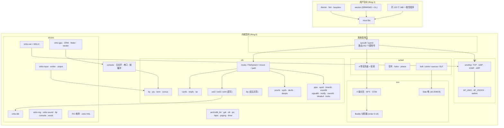
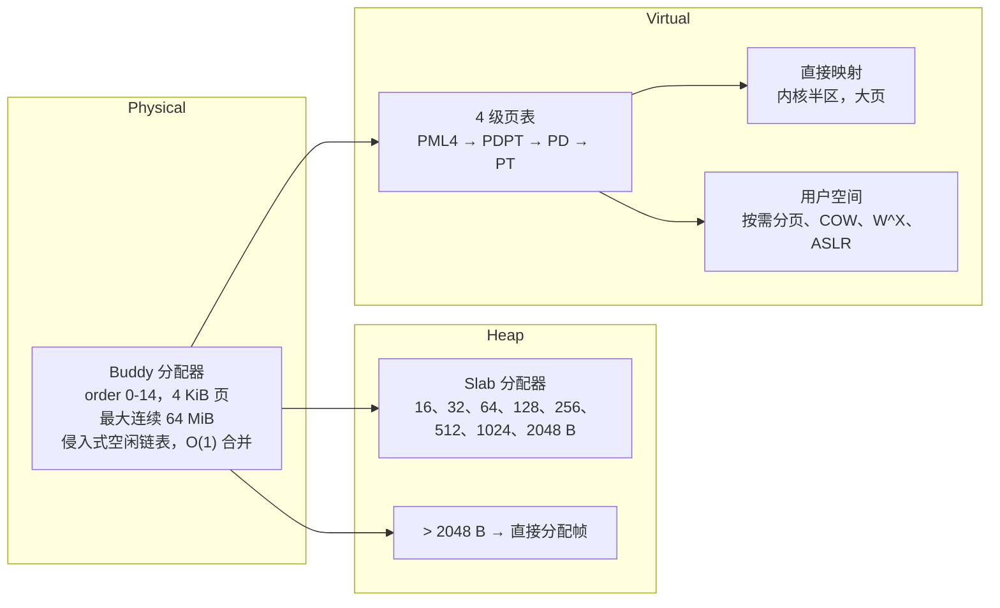
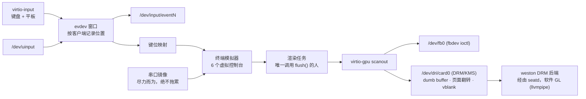
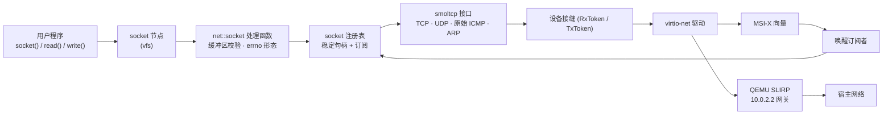

# MPOS

<div align="center">


**经过里程碑验证的操作系统内核**

一个用 Rust 编写的单处理器 x86_64 操作系统内核，由自研的引导加载器在 UEFI 上引导。
每个子系统在构建下一个之前都会被证明是正确的——从帧分配器到完整的交互式 Shell。
兼容 Linux ABI：基于 musl 的二进制程序未经修改即可运行。

[快速开始](#快速开始) · [架构](#架构) · [系统调用](#系统调用) · [里程碑检查](#里程碑检查) · [构建](#构建) · [测试](#测试) · [文档](#文档) · [English](../README.md)

</div>

---

## 概述

**MPOS** 是一个以**里程碑验证**方法论为核心构建的教学与研究型操作系统内核：与其层层叠加然后寄希望于正确，
每一层都在下一层构建之前通过断言和测试被证明是正确的——而且这些证明同时存在于两个地方，任何一处都无法悄然腐化。

- **在主机上。** 与架构无关的逻辑位于内核*库*（`src/lib.rs`）中：帧分配器、映射方案、调度器的策略、
  路径解析、每个文件系统各自的编码方式、每个设备 ioctl 契约中纯逻辑的那一半。它以
  `x86_64-unknown-linux-gnu` 为目标编译，用普通的 `cargo test` 运行。
- **在机器上。** 约 120 个用户态程序在 QEMU 中被引导运行，并且必须报告 `=== PASS`；它们通过真正的
  `syscall` 指令使用 Linux ABI，系统调用号取自内核自己的 `src/syscall/linux/nr.rs`，
  因此内核和测试之间不可能在某个号码上产生分歧而其中之一却仍然能构建成功。

依赖机器的代码——描述符表、端口 I/O、virtio 环、引导交接——都被隔离在
`#[cfg(target_os = "none")]` 之后，这正是主机构建保持与硬件无关的原因。

### 核心特性

| 特性 | 说明 |
|---------|-------------|
| **自研 UEFI 引导加载器** | `mpos-boot` 从 ESP 读取内核、initramfs 和命令行，构建页表和高半区映射，应用内核的重定位然后跳转——之后便不复存在。没有第三方引导加载器，没有 ISO |
| **Linux ABI 兼容** | 252 个 Linux x86_64 系统调用号被命名并路由；基于 musl 的二进制程序（Alpine、busybox、`apk`、`fish`、weston）未经修改即可运行 |
| **帧缓冲控制台** | virtio-gpu 2D scanout，一个在引导后*真正迁移到帧缓冲上*的内核控制台，虚拟控制台（`Ctrl-A 1..6`；镜像在 `tty1`..`tty4` 上运行 `getty`），以及一个尽力而为的串口镜像——它绝不会拖累窗口刷新 |
| **DRM/KMS + fbdev** | 带 fbdev ioctl 的 `/dev/fb0`，以及遵循 Linux DRM UAPI 的 `/dev/dri/card0`——dumb buffer、页面翻转、vblank 事件、render node、PRIME。这正是 **weston** 走的路径：它的 DRM 后端经由 `seatd`，配合 Mesa 的软件 GL（llvmpipe），基于 GBM dumb buffer。没有 GPU 侧 3D，也没有 virgl |
| **输入** | virtio-keyboard 与 virtio-tablet 以 evdev 节点呈现（`/dev/input/eventN`、能力 ioctl、按打开文件粒度的 grab），外加 `/dev/uinput`，程序可以借此创建属于自己的设备 |
| **直写式 ext2/ext4** | 完整的可读写 ext2、ext3 和 ext4——extent、目录哈希、4 路组相联块缓存——采用直写（write-through）语义：无日志、无脏页追踪、崩溃即可见 |
| **优先级调度器** | 四个优先级带（LOW、NORMAL、HIGH、CRITICAL）之间严格优先级，带内轮转，基于截止时间的休眠，COW fork，按需分页的栈增长 |
| **信号** | 处理函数通过真正的 `rt_sigframe` 投递，掩码强制执行，`sigqueue`/`siginfo` 载荷，`SIGKILL`/`SIGSTOP` 不可屏蔽 |
| **TCP/IP 网络** | 由 smoltcp 驱动的协议栈，在 virtio-net 上支持 TCP、UDP、原始 ICMP 和 ARP，MSI-X 中断，以及事件驱动的等待——帧到达时唤醒阻塞的读取方，而不是等下一个时钟节拍 |
| **AF_UNIX** | 基于路径的 `SOCK_STREAM`，支持 `SCM_RIGHTS` 描述符传递、`SCM_CREDENTIALS` 和 `SO_PEERCRED`——足以运行真正的 `dbus` 代理和 `udev` 的工作进程通道 |
| **交互式 Shell** | Alpine 的 OpenRC 引导后进入由 pty 支撑的 `/dev/tty1` 上的 `getty`（默认四个控制台，在 `rootfs/etc/inittab` 中修改），支持管道、重定向、后台作业和可脚本化的 init |

---

## 架构

`docs/ARCHITECTURE.md` 中有完整的模块图、实测的依赖边、引导序列图以及分层规则。这里只是概要。

### 系统总览



### 引导流程

```mermaid
graph TD
    A["UEFI 固件"] --> B["EFI/BOOT/BOOTX64.EFI — mpos-boot"]
    B --> B1["从 ESP 读取 mpos.elf、initramfs.tar、mpos.cmdline"]
    B1 --> B2["内存映射 · 页表 · KERNEL_VIRT_BASE 处的高半区直接映射"]
    B2 --> B3["重定位 PIE 镜像 · exit boot services"]
    B3 --> C["_start(handoff) — ring 0，内核栈，中断关闭"]
    C --> C1["console::init() · enable_user_sse() · handoff::collect()"]
    C1 --> D["mm::init() → logging::init()"]
    D --> E["init_arch：gdt · idt · pic · timer · rtc · syscall 门 · paging::install()"]
    E --> F["init_sched：接管引导任务"]
    F --> G["init_vfs：ramfs 根，解包 initramfs"]
    G --> H["init_pci → init_blk：virtio-blk，GPT 扫描，挂载 /mnt"]
    H --> I["init_net：virtio-net，smoltcp，10.0.2.15/24"]
    I --> J["init_virtio：rng · console · gpu · input · sound · 9p · vsock"]
    J --> K["rand::init()：由 RDRAND + 宿主熵源播种的 ChaCha20"]
    K --> L["handoff_to_init：以 PID 1 启动 /init，引导任务挂起"]
    L --> M["initramfs /init：挂载 proc · sysfs · devtmpfs"]
    M --> N["挂载 /dev/vda2 (ext4)，挂载 proc/sys/tmp/run，迁移 /dev，devpts"]
    N --> O["switch_root /sysroot /sbin/init"]
    O --> P["OpenRC：服务、devfs、网络"]
    P --> Q["在 /dev/tty1 上运行 shell (pty 支撑)"]
```



内核只挂载它自己的 ramfs 根，别无其他。`/proc`、`/sys`、`/dev`、真正的根以及
`switch_root` 全部属于 initramfs 的 `/init`（`initramfs/init`），因为一个抢先组装它们的内核
会留下系统的所有者无法卸载的碎片。

### 内存管理



### 控制台、显示与输入



### 网络数据通路



---

## 系统调用

`src/syscall/linux/nr.rs` 命名了 **252 个 Linux x86_64 系统调用号**；每一个都由
`src/syscall/linux/mod.rs` 中的分发表路由，其中约 234 个真正工作——剩下的少数几个回答
`ENOSYS`，由 `NOTES.md` 作为剩余 ABI 缺口追踪记录（`fanotify`、`keyctl`、`userfaultfd`、
实时信号 33–64、`io_uring`）。POSIX 间隔定时器（`timer_create` 222 … `timer_delete` 226）
以它们本来的五个调用号加入了真正工作的集合；`SIGRTMIN`（32）可以被排队、屏蔽和等待——
那是 musl 的 `SIGEV_THREAD` 辅助函数唯一需要的实时信号号——而针对它的*处置方式*及其上方的
整个范围仍然被拒绝。

处理函数所在的位置，以及这些文件为什么这么大：

| 处理模块 | 调用号数 | 回答的内容 |
|---|---:|---|
| `syscall/linux/fs.rs` | 135 | 一切携带路径或操作文件描述符的调用：`open`/`openat`/`openat2`、`stat`/`statx`、`getdents64`、`renameat2`、`splice`、`mount`、`ioctl`、`fcntl`、管道、`sendfile`、`fallocate`、`statfs` |
| `syscall/linux/proc.rs` | 50 | 内存与进程机制：`mmap`/`munmap`/`mremap`/`brk`/`mprotect`、`fork`/`clone`/`vfork`、`execve`、`exit_group`、`wait4`/`waitid`、`ptrace`、`process_vm_readv`/`writev`、`nanosleep`、`clock_gettime`、`gettimeofday` |
| `syscall/linux/posix.rs` | 50 | POSIX 补全集：身份族（`setreuid`、`getresuid`、`capget`……）、能力、`sched_*`、`getpriority`/`setpriority`、内存建议（`msync`、`madvise`、`mlock`）、挂钟设置器、面向自身的信号 |
| `syscall/linux/abi.rs` | 12 | 纯 ABI 事实——标志值、结构体布局、参数校验、编码——以主机方式编译，因此手册页契约可被单元测试 |
| `syscall/linux/nr.rs` | — | 调用号本身，被测试套件以 `#[path]` 引入，让内核与测试共享同一张表 |

`ioctl` 值得一提：目前 fbdev、DRM、RTC、uinput、evdev、TTY 和块设备的请求号族都在
`fs.rs` 中解析，这正是该文件有 6300 行的原因。`NOTES.md` Phase 11（Step B）就是把这些契约
交还给各自驱动的计划。

与 Linux 有意为之的分歧按子系统收集在 `NOTES.md` 中——例如 IPv4 上的 `listen(2)` 返回
`EOPNOTSUPP`（协议栈只支持出站）、`SO_LINGER{on,0}` 保持正常关闭而不是伪造、
`unshare`/`setns` 先校验再拒绝，以及 `seccomp` 支持 `STRICT` 但不支持 `FILTER`。
它们记录在那里，而不是藏在这里。

---

## 里程碑检查

每个子系统都在下一个构建之前被证明正确，而这些证明的"在机器上"的那一半会向串口日志打印标记。
它们**仅**在命令行携带 `mpos.selftest` 时才运行——`cargo xtask test` 会设置它，普通引导不会——
因此普通引导不需要付出这些检查所需的半秒时钟等待和调度器休眠。

| 标记 | 子系统 | 验证内容 |
|:------:|-----------|------------------|
| `M0_OK` | 分配器 | 全局分配器端到端工作（`Vec`、`String`） |
| `M1_OK` | 中断 | PIT 以预期频率滴答；断点异常可被捕获并返回 |
| `M2_OK` | 帧与堆 | Buddy 块互不重叠且能正确合并；每个 slab 大小级别都守住自己的契约；堆与帧分配器对"发出去了什么"的意见一致 |
| `M3_OK` | 分页 | 内核运行在自己的页表上；整个镜像范围内 `text` 为 `r-x`、`rodata` 为 `r--`、`data` 为 `rw-`；用户地址空间彼此隔离并共享同一个内核半区；两者都被拆除且不泄漏一帧 |
| `M4_OK` | 调度器 | 轮转、抢占、休眠、空闲唤醒、基于优先级的核心窃取；每个任务都被回收，每个栈都被归还 |
| `M6_OK` | 系统调用 | 分派门在任务内部正确应答；经由分派的 `exit_group` 结束任务 |
| `M7_OK` | VFS | ramfs 根、一个被路径解析穿越的挂载点、两个任务通过 fd 表读写同一个文件 |
| `M8_IPC_OK` | 管道、TTY、信号 | 字节在两个任务之间穿过管道；无读取方时的 `EPIPE`；行编辑、回显与 `Ctrl-D`；`SIGTERM`/`SIGKILL` 送达；`kill(0)` 探测正确应答 |
| `M8_OK` | init 交接 | `/init` 以 PID 1 运行，fork，exec 一个 shell，并保持存活 |

不存在 M5，M8 之上也没有任何检查——验证止步于里程碑编号历史上的那个空缺，而编号保持原样，
因为 CI 日志和 `NOTES.md` 都引用它。本 README 的早期版本曾描述过一条一路排到 M8 之上的完整
里程碑流水线，它从未以那种形式存在过；关于什么被证明了的权威记录是测试套件，而不是这些标记。

**真正的门禁是自检。** `cargo xtask test` 先运行主机单元测试，然后引导 `tests.toml` 选中的
用户测试程序——所有不在任何分组中的程序——要求每个程序打印 `=== PASS`，并且整个运行以
`=== SUMMARY` 行和 QEMU 退出码 33 结束。需要机器之外东西的程序，或者做测量而非断言的程序，
被放在分组里并按名字运行（`--groups`、`--all-groups`），这才使红色的门禁依然是关于内核的
陈述。参见[测试](#测试)。

---

## 快速开始

### 前置条件

- **Rust nightly**，带 `rust-src`、`rustfmt`、`clippy`
- 四个目标：`x86_64-unknown-none`（内核）、`x86_64-unknown-uefi`（引导加载器）、
  `x86_64-unknown-linux-musl`（用户程序）、`x86_64-unknown-linux-gnu`（主机测试 + xtask）
- **QEMU**（`qemu-system-x86_64`）、**OVMF**（`OVMF_CODE.4m.fd` / `OVMF_VARS.4m.fd`）
- `qemu-img`、`qemu-nbd`、`sfdisk`、`partx`、`blkid`、`mkfs.ext4`、`mkfs.fat`、`tar`、`sudo`
- 首次构建 `initramfs`/`rootfs` 时需要网络连接（拉取 Alpine 软件包）

```bash
rustup toolchain install nightly
rustup component add rust-src rustfmt clippy --toolchain nightly
rustup target add x86_64-unknown-none x86_64-unknown-uefi \
                   x86_64-unknown-linux-musl x86_64-unknown-linux-gnu
```

### 构建并运行

```bash
cargo xtask all          # 内核 + 引导加载器 + initramfs + 磁盘镜像 + Alpine rootfs（需要 sudo）
cargo xtask run          # 引导运行；若有内容过期会先重新构建
```

内核引导、拉起 initramfs、pivot 进入 Alpine 根文件系统，然后把你放进一个交互式 shell——
在串口上、在 QEMU 窗口里，或者两者兼有，取决于下面哪种模式。

`cargo xtask run` 有一个模式参数，它同时决定窗口和串口如何接线，以及客户机被告知拥有哪些
控制台。对虚拟机的告知使用 Linux 自己的 `console=` 词，仅此而已：列表上的每个控制台都会
收到日志，而最后一个控制台是首选项——对它的写入会等待，而不是被丢弃。

| 模式 | 你得到什么 | 客户机 `console=` |
|------|--------------|------------------|
| `terminal` | 仅串口，无窗口——无损日志；`/dev/fb0` 依然存在，但没有任何东西画在它上面 | `console=ttyS0` |
| `gui` | 整台机器都在窗口里：文本控制台——日志、虚拟控制台、登录、shell——都显示在那里，宿主终端保持安静，串口线被复制到 `build/serial.log`；合成器在运行时以 `./start-weston.sh` 接管了屏幕 | `console=tty0` |
| `mirror` | 窗口外加串口上的尽力而为副本（默认） | `console=ttyS0 console=tty0` |

```bash
cargo xtask run --mode terminal      # 观看引导日志
cargo xtask run --mode gui           # 在窗口里看这台机器
```

之所以是三种模式，是因为虚拟机的控制台和启动器的窗口是两个独立的问题，
而每种模式各自拥有一份答案。命令行永远说不出的是*谁在画屏幕*：合成器在运行时
通过 `DRM_IOCTL_SET_MASTER` 和 `KDSETMODE` 取得屏幕，无论它在哪种有窗口的模式下启动。

`xtask/README.md` 以中英双语记录了每一条命令、每一个标志和每一个环境变量。简表如下：

| 命令 | 作用 | 需要 root？ |
|---|---|---|
| `cargo xtask build` [`--arch x86_64\|aarch64`] | 内核 + UEFI 引导加载器，`--arch` 指定哪台机器（它同时决定两个 `--target`） | 否 |
| `cargo xtask initramfs` | 构建 initramfs 归档 | 是 |
| `cargo xtask disk` | 创建空白 GPT 镜像 | 是 |
| `cargo xtask rootfs` | 把 Alpine 安装进镜像（会刷新 initramfs） | 是 |
| `cargo xtask run` | 在 QEMU 中引导，过期时重新构建 | 视需要 |
| `cargo xtask all` | 以上全部，按顺序 | 是 |
| `cargo xtask test` | 主机单元测试 + `tests.toml` 选中的用户测试程序，在 QEMU 中 | **否** |
| `cargo xtask clean` | 删除 `build/` 和 `target/` | 视需要 |

---

## 构建

构建是一个 Cargo workspace，只有一个前端。`xtask` 以你自己的用户身份编译，只在确实需要的
步骤（写块设备、挂载镜像、`chroot`）上提权，并在完成后把产物交还回来。

```bash
cargo xtask build                        # 只构建内核和引导加载器
cargo build --target x86_64-unknown-none # 同样的东西，不经过 xtask
```

### 磁盘镜像

`cargo xtask all` 组装出 `build/mpos-uefi-x86_64.img`：一个带两个分区的 GPT 磁盘。

| # | 名称 | 类型 | 大小 | 内容 |
|---|------|------|------|----------|
| 1 | `efi` | FAT32，可引导 | 128 MiB（来自 `rootfs.toml`） | `EFI/BOOT/BOOTX64.EFI`（引导加载器）、`mpos.elf`、`initramfs.tar`、`mpos.cmdline` |
| 2 | `system` | ext4 | 2 GiB 镜像的剩余部分 | Alpine 根文件系统——`/sbin/init`、OpenRC、musl、busybox、`apk` |

QEMU 在 OVMF 下直接引导它：没有 ISO，没有光驱，没有 loop 设备，`cargo xtask test`
也不需要 root——它引导的是一个 QEMU 合成为虚拟 FAT 的目录。

### 镜像里装什么

`rootfs.toml` 决定软件包、文件系统、大小、主机名、DNS 和用户账户；`machine.toml`
决定这个镜像被引导在什么样的机器上（内存、CPU、设备、窗口、常驻运行模式），
它是单独的文件，这样调机器不会让镜像失效；`initramfs.toml` 对早期用户空间做同样的事。
三份配置都各只有一个文件、同时描述**两台**机器，用三个段：`[default]` 是两台共享的基线，
`[x86_64]` / `[aarch64]` 是各自那一半——第二台不共享的值只在它自己的段里写一次，
第一台看不到。键名带前缀（`rootfs.mirror`、`system.hostname`、`user.name`）。
具体的文件以真实文件的形式放在 `rootfs/` 和 `initramfs/` 之下，在从 toml 写入的任何内容
*之后*叠加上去——所以目录树里的文件说了算，`/etc/inittab`、`/etc/network/interfaces`
和 `/init` 就是这样被修改的。

### 跨架构

不可用，而且配置也不再假装可用：`.cargo/config.toml` 里没有 `aarch64-unknown-none`
profile，`rust-toolchain.toml` 里也没有这个目标，因为过去放在那里的那个 profile 指向
`arch/aarch64/linker.ld`，而这样的脚本从未存在过（`NOTES.md` Phase 11 Step A 移除了它）。
`NOTES.md` §9.1 列出了一个真正的 aarch64 移植所需要的东西——异常向量、GIC、页表、PSCI、
通用定时器、UART——其中没有任何一项已经写好。

---

## 测试

三个层次，其中中间那个是门禁。

### 1. 主机单元测试

```bash
cargo test -p mpos --lib --target x86_64-unknown-linux-gnu
cargo test -p mpos-xtask --target x86_64-unknown-linux-gnu
```

内核中 491 个 `#[test]` 函数，外加 `xtask` 中的 25 个。它们覆盖与架构无关的核心：
buddy 分配器和 slab 堆、调度器的策略与信号状态、路径解析与挂载、ext2/ext3/ext4 编码
（包括逐字节读取一个大文件，以及挂载主机上 `mke2fs` 生成的镜像）、ext4 块缓存的命中计数、
ramfs 的分块及其字节预算、管道环、epoll 的就绪规则、evdev 窗口的客户端记账、
inotify 的合并、文件锁表、键位映射、历法、shebang 解析器和 ABI 常量。

> **`--target` 是必须的。** 根目录的 `.cargo/config.toml` 固定了 `[build] target =
> "x86_64-unknown-none"`，所以裸的 `cargo test` 会试图在裸机上运行测试。

### 2. 自检扫描——门禁

```bash
cargo xtask test        # 不需要 root
```

它构建两个用户测试 crate，把它们打包进一个一次性的 initramfs（附带一个生成的 `/init`），
无头引导，然后解析串口日志：

```
=== RUN  t-filelock
=== PASS t-filelock
=== SUMMARY pass=120 fail=0
=== END
```

挂起、崩溃或从未打印 `=== PASS` 的程序算作失败，而且整个运行必须以汇总行*加上*
QEMU 的干净调试退出（退出码 33）结束。`MPOS_TEST_TIMEOUT` 可以覆盖 900 秒的时间预算。

哪些程序被引导是 `tests.toml` 的回答，不是 `/init` 的：harness 把选中的二进制布放进 `/bin`，
客户机运行交给它的那些。不在任何分组中的测试总是运行；预置的分组是 `external`（需要宿主网络
或宿主上的监听进程）、`slow`（测量，或以秒计的工作量）和 `diagnostic`（根本不算检查），
`cargo xtask test --groups <a,b>` / `--all-groups` 则有意运行它们。扫描会按分组打印它略过了
什么，所以较小的数字永远不会被误认为较小的测试集。

### 3. 用户测试程序

约 120 个程序，按每个程序的需要划分：

| 组 | 位置 | 构建方式 | 钉住的内容 |
|-------|-------|----------|--------------|
| **纯系统调用** | `user/abitest/src/bin/syscall/`（86 个） | `no_std`、原始 `syscall`、静态 `ET_EXEC` | 一个系统调用族在自足资源上的 ABI 契约：成功的形态、它声称的每一个 errno，以及手册页固定的边界情况 |
| **集成** | `user/abitest/src/bin/integration/`（22 个） | `no_std`、原始 `syscall` | 一个设备、网络、另一个进程镜像，或一个子系统端到端——外加计时仪器（`t-forkcost`、`t-pipecost`、`t-netlat`） |
| **std 侧** | `user/tests/src/bin/`（12 个） | 静态 musl + `rustix` | 真正的 musl 程序所使用的接口面，钉住那些从宿主语言最容易固定的行为：socket、名字解析、进程派生 |

`no_std` 程序通过 `#[path = "../../../lib/lin.rs"]` 从内核自己的 `nr.rs` 取调用号，
所以一个错误的号码是构建失败，而不是一个错误的测试。`std` 测试刻意使用 `rustix`
而不是内联汇编：手写的 `syscall` 指令可能对一个有错的内核通过，因为 errno 不过是
寄存器当时碰巧装着的值。

### 4. Fuzzing

`fuzz/` 是一个独立的 workspace，带有 18 个 libFuzzer 目标，覆盖那些决定内核从字节里
信任什么的解析器：ELF、ustar、ext2/ext4 磁盘结构、分区表、VFS 路径、控制台的转义
序列解析器、键位映射、PCI BAR 尺寸探测、调度器的策略以及输入协议。

```bash
cd fuzz
cargo fuzz run ext4_image
cargo fuzz list
```

---

## 项目结构

```
mpos/
├── src/                     # 内核 crate：lib.rs（主机可测）+ main.rs（引导入口）
│   ├── lib.rs               # 库根——主机构建编译的内容
│   ├── main.rs              # _start → kernel_main → 里程碑检查 → init 交接 → 挂起
│   ├── console.rs           # 日志环、串口输出、向帧缓冲的迁移
│   ├── binfmt.rs            # shebang (#!) 解释器
│   ├── date.rs              # 公历历法运算
│   ├── evdev.rs             # evdev 记录窗口与按客户端位置（主机可测）
│   ├── uinput.rs            # uinput 的接口：请求与位图（主机可测）
│   ├── pci.rs               # PCI 设备模型与 Linux 的写法（主机可测）
│   ├── rand.rs              # ChaCha20 PRNG：/dev/urandom、getrandom
│   ├── uevent.rs            # kobject 事件与 netlink 线格式
│   ├── logging.rs           # 写入 COM1 的 tracing subscriber
│   ├── sync/mod.rs          # 加锁纲领（critical_section，绝不用 spin）
│   │
│   ├── arch/x86_64/         # 依赖机器的那一半
│   │   ├── context.rs       #   任务上下文切换、惰性 FPU（CR0.TS + #NM）
│   │   ├── critical.rs      #   critical_section（cli/sti）
│   │   ├── gdt.rs           #   GDT + TSS
│   │   ├── idt.rs           #   中断处理函数（timer、#BP、#PF、#NM、syscall、MSI-X）
│   │   ├── lapic.rs         #   本地 APIC（EOI、MSI-X 向量编程）
│   │   ├── paging.rs        #   4 级页表、W^X、COW、AddressSpace
│   │   ├── pic.rs           #   8259 PIC（IRQ0→32、IRQ4→36）
│   │   ├── rtc.rs           #   作为挂钟锚点的 CMOS RTC
│   │   ├── syscall.rs       #   syscall/sysret 门
│   │   └── timer.rs         #   250 Hz 的 PIT + TSC 亚刻度读数
│   │
│   ├── mm/                  # 内存管理
│   │   ├── pframe.rs        #   buddy 帧分配器（MAX_ORDER 12）
│   │   ├── heap.rs          #   slab 内核堆（16–2048 B）
│   │   ├── vm.rs            #   映射方案、KernelSections
│   │   └── elf.rs           #   ELF64 加载器（ET_EXEC 与 ET_DYN + 重定位）
│   │
│   ├── sched/               # 任务
│   │   ├── policy.rs        #   优先级带、轮转、休眠队列
│   │   ├── runtime.rs       #   任务表（64 槽）、切换、fork/exec/wait、拆除
│   │   ├── signal.rs        #   信号编号、挂起位掩码、处置方式
│   │   └── futex.rs         #   futex 等待/唤醒
│   │
│   ├── vfs/                 # 虚拟文件系统
│   │   ├── mod.rs           #   Inode/FileSystem trait、NodeKind
│   │   ├── mount.rs         #   Vfs、挂载表、路径解析、pivot_root
│   │   ├── path.rs          #   路径解析语法
│   │   ├── file.rs          #   fd 表、CLOEXEC、RLIMIT_NOFILE
│   │   ├── ramfs.rs         #   ramfs/tmpfs：分块文件、字节预算
│   │   ├── ext4/            #   ext2/ext3/ext4：super · inode · extent · dir · dx · hash
│   │   │                    #     · alloc · dirent · csum · mapping · cache
│   │   ├── procfs.rs        #   /proc：meminfo、stat、mounts、net、sys 开关、按进程
│   │   ├── sysfs.rs         #   /sys：设备、class、drm、input、uevent
│   │   ├── devfs.rs         #   /dev 节点类型与请求路由
│   │   │                    #     （标准节点集在 drivers/devices.rs 中：
│   │   │                    #      null、zero、tty、console、fb0、dri、rtc0、dsp、hvc0 ……）
│   │   ├── devpts.rs · pty.rs · tty.rs · termios.rs   # 终端
│   │   ├── term/            #   终端模拟器：grid · blit · font · keymap
│   │   ├── vcmux.rs         #   虚拟控制台多路复用器
│   │   ├── pipe.rs          #   管道与 socketpair（环形缓冲、SCM 移交）
│   │   ├── epoll.rs · timerfd.rs · eventfd.rs · signalfd.rs · inotify.rs
│   │   ├── memfd.rs · dmabuf.rs      #   匿名与导出缓冲区
│   │   ├── locks.rs         #   POSIX 记录锁与 flock
│   │   ├── p9.rs            #   9p 客户端（宿主共享）
│   │   └── tar.rs           #   用于 initramfs 的 ustar 解包器
│   │
│   ├── net/                 # 网络
│   │   ├── mod.rs           #   smoltcp 协议栈、注册表、唤醒、netlink 写入侧
│   │   ├── socket.rs        #   AF_INET / AF_NETLINK socket 系统调用
│   │   ├── unix.rs          #   AF_UNIX：路径 socket、SCM_RIGHTS、SO_PEERCRED
│   │   ├── rtnl.rs          #   rtnetlink：addr/route/link，实时生效
│   │   └── vsock.rs         #   AF_VSOCK
│   │
│   ├── drivers/             # 设备
│   │   ├── pci.rs           #   PCI 配置空间（机制 1）、枚举
│   │   ├── devices.rs       #   设备注册表、uevent 发布
│   │   ├── serial.rs        #   COM1：发送环、中断驱动的接收
│   │   ├── rtc_dev.rs       #   /dev/rtc0（节点；时钟在 arch::x86_64::rtc）
│   │   ├── qemu.rs          #   isa-debug-exit 测试端口
│   │   ├── drm.rs           #   /dev/dri/card0：Linux DRM/KMS UAPI
│   │   ├── uinput.rs        #   /dev/uinput
│   │   ├── video/           #   渲染任务与呈现引擎
│   │   └── virtio/          #   hal · blk · net · gpu · input · console · rng
│   │                        #     · sound · fs9p · vsock · msix
│   │
│   ├── syscall/             # ABI
│   │   ├── mod.rs           #   错误码、用户缓冲区校验、trace 环
│   │   └── linux/           #   mod（分派）· nr（调用号）· abi · fs · proc · posix
│   │
│   ├── blk/                 # BlockDev trait、GPT/MBR 分区扫描
│   └── boot/                # 引导加载器留下的交接记录
│
├── boot/                    # mpos-boot：UEFI 引导加载器（x86_64-unknown-uefi）
│   └── src/                 # main（有序序列）· elf · vm · handoff
│
├── user/                    # 运行在 mpos 上的程序
│   ├── src/bin/             #   随镜像发布的普通 std 程序（hello.rs）
│   ├── tests/               #   mpos-user-tests：std 侧测试程序（musl）
│   ├── abitest/             #   mpos-user-abi：no_std ABI 一致性套件
│   │   ├── lib/lin.rs       #     harness：syscall 桩、判定协议
│   │   └── src/bin/         #     syscall/（86 个）· integration/（22 个）
│   └── staging/             #   草稿源码，未接入任何构建
│
├── xtask/                   # 构建/运行/测试前端（见 xtask/README.md）
├── fuzz/                    # libFuzzer 目标（独立 workspace）
├── arch/x86_64/linker.ld    # 内核链接脚本
├── rootfs/                  # 叠加进 Alpine 根文件系统的具体文件
├── rootfs.toml              # 客户机镜像里有什么
├── machine.toml             # 这个镜像被引导在什么机器上（宿主资源、运行模式）
├── tests.toml              # 默认扫描运行哪些用户测试（以及略过哪些）
├── initramfs/               # 叠加进早期用户空间的具体文件（init 在这里）
├── initramfs.toml           # 早期用户空间里有什么
├── .cargo/config.toml       # 目标、rustflags 和 `cargo xtask` 别名
├── rust-toolchain.toml      # nightly + 四个目标
├── docs/                    # ROADMAP.md · NOTES.md · ARCHITECTURE.md · UAPI.md · README.zh.md
├── README.md · AGENTS.md
└── LICENSE
```

`docs/ARCHITECTURE.md` 把这同一棵树画成了依赖图，附有层与层之间实测的边；
`AGENTS.md` 是给即将做出改动的人（或任何东西）的精简版指南。

---

## 设计原则

- **库/二进制拆分。** crate 是一个库，这样主机才能测试它。机器代码被隔离在
  `target_os = "none"` 之后；纯逻辑——算术、编码、解析器、策略——留在主机一侧，
  即使它唯一的调用者是裸机。
- **一张系统调用表。** 测试套件以 `#[path]` 引入 `src/syscall/linux/nr.rs`，所以内核
  与测试不可能在某个调用号上悄然漂移而不触发构建失败。
- **单处理器的简单性。** 所有共享状态都是 `critical_section::Mutex<RefCell<T>>`——
  关中断*就是*互斥。刻意从不使用 `spin::Mutex`：在本核刚刚抢占的任务持有的锁上忙等
  会死锁。任何锁下都不休眠。
- **每一次唤醒都是事件，不是节拍。** 阻塞调用在它等待的那件事上挂起，由到达唤醒，
  而不是由下一个时钟中断唤醒。正是这一条纪律把回环 `ping` 从 7.5 ms 降到 0.3 ms，
  把两进程管道交接从 7 MiB/s 提到 10 168 MiB/s（`NOTES.md` §10.1、§10.4）。
- **没有数字就不作声明。** `NOTES.md` 中的性能改动都带有来自套件内仪器的前后测量——
  `t-forkcost`、`t-pipecost`、`t-netlat`，或者一个统计设备读取次数的主机测试。
- **分歧要记录，不要隐藏。** MPOS 有意与 Linux 不同的地方，原因和钉住它的测试都写在
  特性旁边。

### 值得知道的行为

| 行为 | 说明 |
|---|---|
| **COW fork** | 共享页被标记为只读并带 COW 位；`#PF` 处理函数在首次写入时复制。帧的引用计数存放在 buddy 分配器中 |
| **按需分页的栈** | 起始 16 页，出错时增长，受 `RLIMIT_STACK` 约束，检查时留有 `STACK_GROWTH_SLACK` 余量 |
| **直写式 ext4** | 每次 `write_at()` 都抵达设备。没有日志、没有脏页追踪、没有后台回写：简单，并且构造上崩溃即可见（镜像同样以 `^has_journal,^metadata_csum` 构建，原因一致） |
| **信号** | 通过真正的 `rt_sigframe` 投递，所以处理函数会被调用，而 `rt_sigreturn` 会恢复被打断的代码。`SIGKILL` 和 `SIGSTOP` 不可屏蔽 |
| **ASLR** | `ET_DYN` 镜像、它的解释器、栈顶和 `mmap` 区域都在每次 `exec` 时重新抽签；`ET_EXEC` 镜像保持它链接时的地址，因为固定地址的含义就是这个 |
| **Slab 分配与大请求** | 超过 2048 B 的请求绕过 slab 直接取帧；堆会缓存已释放的空槽，这就是 `/proc/meminfo` 里的"空闲"内存不是全部真相的原因 |
| **内核 panic 会终结这台机器** | `panic = "abort"`，加上一个打印栈扫描并以 `35` 退出 QEMU 的 panic 处理函数。全局分配器的失败路径仍然是一个 panic——`NOTES.md` §8.0 中的未决项 |

---

## 文档

| 文件 | 内容 |
|---|---|
| `README.md` | 本文件的英文版：MPOS 是什么，以及如何构建、运行和测试 |
| `AGENTS.md` | 工作指南：命令、约定、添加系统调用或测试的配方、已知的坑 |
| `docs/README.zh.md` | 本文件：MPOS 是什么，以及如何构建、运行和测试（中文版，与英文版逐节对应） |
| `docs/ARCHITECTURE.md` | 依赖图、引导与系统调用序列、按层的所有权划分、模块间的实测边，以及分层违规 |
| `docs/ROADMAP.md` | 规划：特性路线图与状态板、各阶段剩余工作、优先级总览 |
| `docs/NOTES.md` | 证据：全部测量、门禁记录、教训与陷阱——实测的性能工作，以及 Phase 11 的架构债务审计及其整改计划 |
| `docs/UAPI.md` | 以清单形式呈现的用户空间可见接口面：系统调用、设备 ioctl、结构体布局和标志词汇表，每一行都带着 Linux 的回答、本内核的回答和那个钉子——一份关于什么是*已服务*、什么是*诚实拒绝*、什么是*错误形态*的工作清单 |
| `xtask/README.md` | 每一条构建/运行命令、标志和环境变量（中英双语） |
| `fuzz/README.md` | 每个 fuzz 目标的输入是什么 |

---

## 许可证

本项目以 [MIT 许可证](LICENSE)授权。

---

<div align="center">
<sub>用 Rust 构建——逐一里程碑，证明其正确。</sub>
</div>
